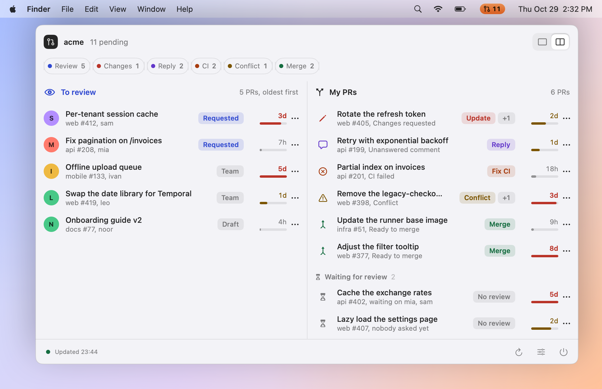
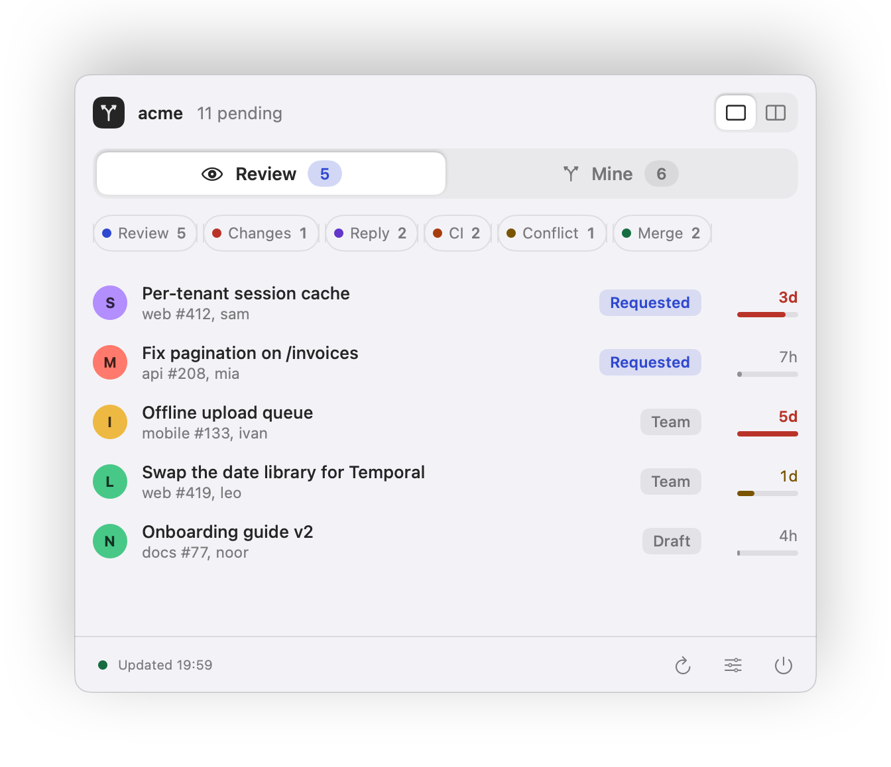
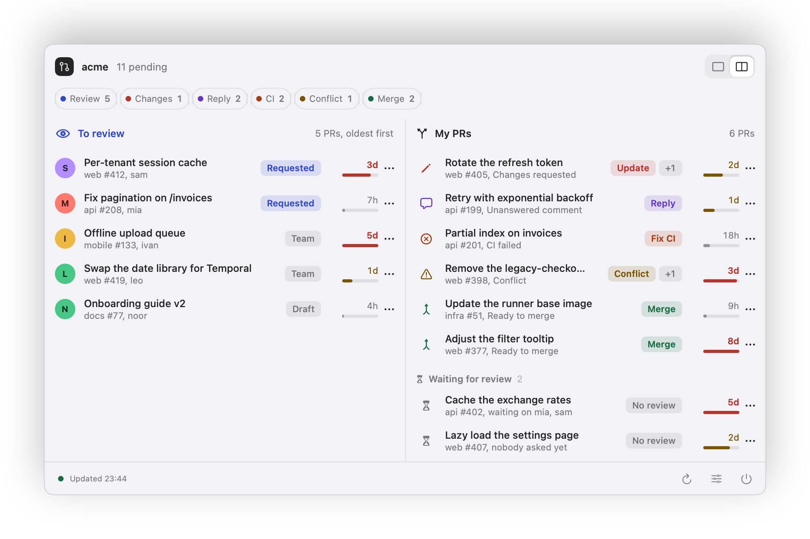
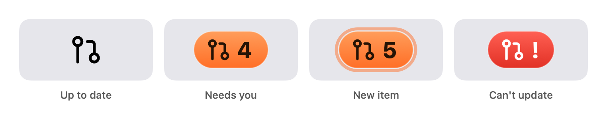
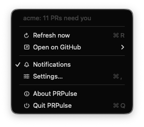
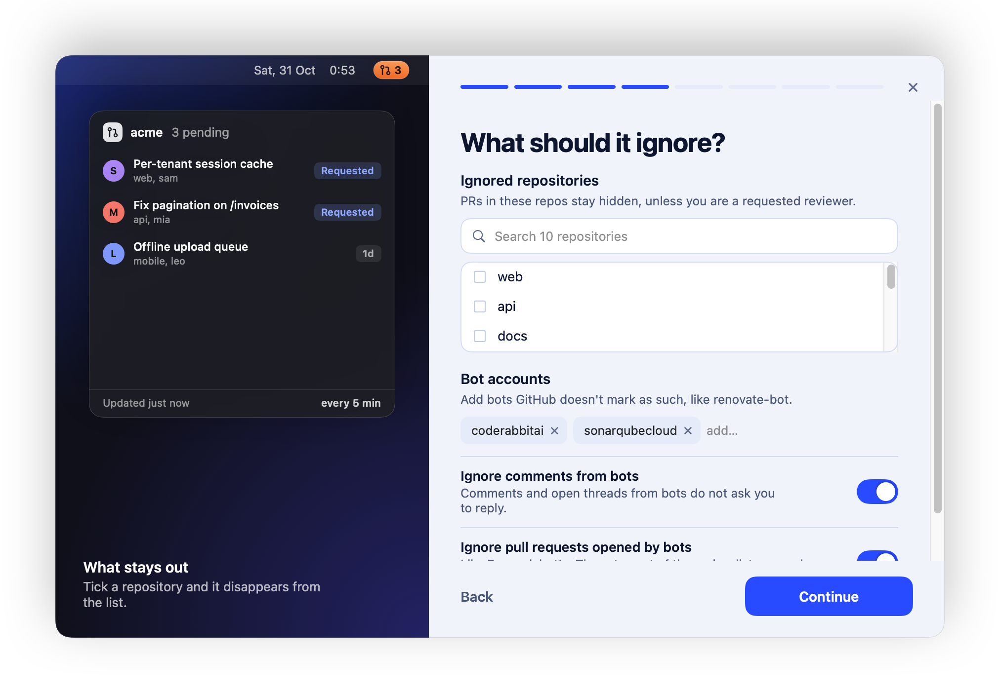
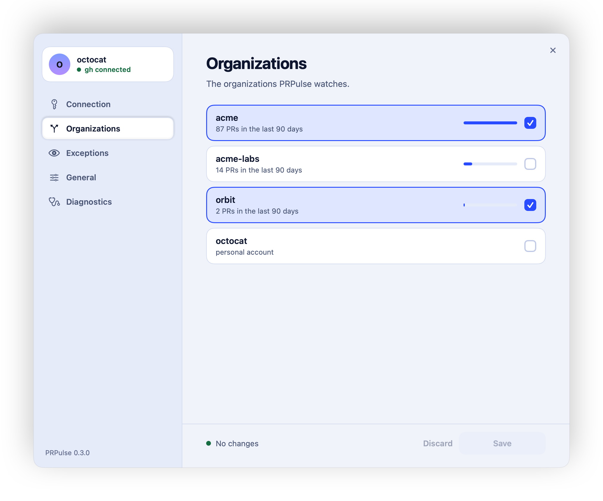

<p align="center">
  
</p>

<h1 align="center">PRPulse</h1>

<p align="center">
  <b>Know which pull requests need you, before anyone has to ask.</b><br>
  A native menu bar app for macOS that watches one GitHub organization and tells you what to act on.
</p>

<p align="center">
  <a href="https://github.com/felipeferrarini/prpulse/releases/latest"></a>
  <a href="#install"></a>
  <a href="Package.swift"></a>
  <a href="#install"></a>
  <a href="LICENSE"></a>
</p>

<p align="center">
  <a href="#install">Install</a> ·
  <a href="#what-you-get">What you get</a> ·
  <a href="#what-counts-as-needs-you">What counts</a> ·
  <a href="#privacy">Privacy</a> ·
  <a href="#development">Development</a> ·
  <a href="README.pt-BR.md">Português</a>
</p>

<p align="center">
  <picture>
    <source media="(prefers-color-scheme: dark)" srcset="docs/images/hero-dark.png">
    
  </picture>
</p>

## Why

Reviewers leave comments you only notice hours later. Teammates open PRs that sit for days because nothing reminds you to look. And "what do I need to do today?" means opening five GitHub tabs.

PRPulse polls GitHub every few minutes, keeps **two short lists** in your menu bar, and changes its icon (plus one notification) the moment something new needs you. It is built around a single question: *what is waiting on me?*

## What you get

### Two lists, ordered by what to do first

**To review** has every open PR in the organization that you haven't reviewed yet, even when nobody asked you. The ones that requested you come first, and each row shows how long it has been waiting, in amber after a day and red after three. **My PRs** has your own PRs that need an action from you, each tagged with the verb that clears it: *Update*, *Reply*, *Fix CI*, *Conflict*, *Merge*.

Tap the action filters to dim everything else, or switch between a single view and a side by side one. The choice is remembered.

Under **My PRs** there is a quieter section, **Waiting for review**: your own PRs that went a couple of days (you choose how many) without a single review. They ask nothing of you and never change the icon, but each one has a *Copy link* button so you can nudge the right person.

Every row has a **⋯** menu: open on GitHub, copy the link and, on the review list, *Mute this repository* so it stops showing without opening Settings.

<table>
  <tr>
    <td width="50%" align="center">
      <picture>
        <source media="(prefers-color-scheme: dark)" srcset="docs/images/popover-dark.png">
        
      </picture>
      <br><sub>Single view, with a tab for each list</sub>
    </td>
    <td width="50%" align="center">
      <picture>
        <source media="(prefers-color-scheme: dark)" srcset="docs/images/popover-split-dark.png">
        
      </picture>
      <br><sub>Side by side, both lists at once</sub>
    </td>
  </tr>
</table>

### An icon that tells you before you look

The menu bar icon is a drawn pull request mark. When everything is clear it is a plain glyph that follows your menu bar theme. When something needs you it becomes one orange pill with the count, rings out when a new item arrives, and turns red if it can't update.

<p align="center">
  <picture>
    <source media="(prefers-color-scheme: dark)" srcset="docs/images/menubar-dark.png">
    
  </picture>
</p>

### A menu one right click away

Right click (or control click) the icon for the things you do without opening the popover.

<table>
  <tr>
    <td width="320"></td>
    <td>
      <ul>
        <li><b>Refresh now</b> (⌘R) instead of waiting for the next cycle.</li>
        <li><b>Open on GitHub</b> jumps to a search already filtered to your organization: PRs to review, or your PRs.</li>
        <li><b>Notifications</b> is a quick mute that doesn't need the settings window.</li>
        <li><b>Settings…</b> (⌘,), <b>About</b> and <b>Quit</b>.</li>
      </ul>
    </td>
  </tr>
</table>

### Set up in a minute

A short wizard connects your account, picks the organization, and asks what to leave out. A live preview of the popover on the left reacts to every choice, so you see the effect of ignoring a repository before you finish.

<p align="center">
  <picture>
    <source media="(prefers-color-scheme: dark)" srcset="docs/images/wizard-dark.png">
    
  </picture>
</p>

Everything can be changed later in **Settings**, which counts your unsaved changes, marks the section they are in, and lets you discard them or save with ⌘S.

<p align="center">
  <picture>
    <source media="(prefers-color-scheme: dark)" srcset="docs/images/settings-dark.png">
    
  </picture>
</p>

### Quiet by design

- **Bots are ignored.** Comments from CodeRabbit, SonarQube and any account GitHub marks as a bot never count (the list is yours to edit).
- **No flood on day one.** The first run learns what is already pending and stays silent. An item notifies once.
- **One organization or several**, with a list of repositories to ignore. A PR in an ignored repository still shows if you are a requested reviewer, directly or through a team such as CODEOWNERS.
- **A global shortcut**, ⌥⌘P, opens and closes the panel from anywhere.
- **Updates itself.** It checks for new versions and installs them in the background (you can turn that off in Settings).
- English and Portuguese, following your system language.

## Install

### Homebrew

```bash
brew tap felipeferrarini/tap
brew trust felipeferrarini/tap
brew install --cask prpulse
```

Recent Homebrew versions refuse to load casks from a third-party tap until you trust it, which is what the `brew trust` line does. Older versions don't have that command; skip it there.

### Download

Get `PRPulse-<version>.dmg` from the [releases page](https://github.com/felipeferrarini/prpulse/releases/latest), drag **PRPulse** to Applications and open it.

> [!IMPORTANT]
> The app is not signed with an Apple Developer ID yet, so on the first launch macOS says it "could not be opened". Click **OK** (not "Move to Trash"), then go to **System Settings → Privacy & Security**, scroll to the Security section and click **Open Anyway** next to PRPulse. The button only shows up after a blocked launch attempt, and only for about an hour.
>
> Prefer the terminal? This does the same:
>
> ```bash
> xattr -dr com.apple.quarantine /Applications/PRPulse.app
> ```
>
> It is a first install thing: the automatic updates should not ask again.

### Build it yourself

A locally built app is not quarantined, so there is no prompt:

```bash
git clone https://github.com/felipeferrarini/prpulse && cd prpulse
make install
```

You need macOS 14 or later and the Swift toolchain (Xcode or the Command Line Tools). Builds are universal (Apple silicon and Intel).

## First run

1. **Connection:** reuse your [`gh`](https://cli.github.com) login, or paste a personal token with the `repo` and `read:org` scopes.
2. **Organizations:** pick one or more. The ones you worked in most over the last 90 days come first, with a count.
3. **Exceptions:** tick repositories to ignore (they are listed from the organization) and edit the bot accounts to skip.
4. **Settings:** refresh interval, notifications, open at login.

> [!NOTE]
> If your organization enforces SAML SSO, authorize the token for it on GitHub, otherwise the icon turns into the error state. The same happens if the organization is renamed or your token can't see it. Classic tokens must include the `repo` scope, or private repositories would never show up.

## What counts as "needs you"

### My PRs

| Action | When it shows |
| --- | --- |
| **Update** | a reviewer requested changes |
| **Reply** (open threads) | there are unresolved review threads; resolve them to clear |
| **Reply** (comment) | the last comment from someone else is newer than your last commit and your last comment (approvals with an "LGTM" body don't count) |
| **Fix CI** | a required check is failing (if the repository defines none, any failed check) |
| **Conflict** | the PR can't merge because of conflicts |
| **Merge** | the merge button is enabled |

A PR with several reasons appears once, with the most urgent one highlighted and a `+1` for the rest, in the order above. Your own drafts only show feedback reasons.

### To review

Open PRs from other people in the organization where you have no submitted review. Requests to you come first, drafts go last, and the oldest wait first. A PR leaves the list as soon as you submit a review, and it doesn't come back when new commits arrive.

### Waiting time

Every row shows how long the PR has been open: neutral under a day, amber from one day, red from three. The little bar fills over four days.

## Privacy

- PRPulse talks **only to GitHub** (`api.github.com` and `github.com`) with your own credentials. There is no server of ours, no analytics and no telemetry.
- A personal token is stored in the **macOS Keychain**. With the `gh` option, the token is read from `gh` on demand and never stored by PRPulse.
- Update checks read one small feed file from your releases page on `github.com`. Nothing about you or your Mac is sent.
- Updates are signed with a key only the maintainer holds, and the app refuses anything that doesn't match.
- The app is open source (MIT), so all of this is checkable.

## Settings at a glance

| Section | What you can change |
| --- | --- |
| **Connection** | `gh` login or a personal token |
| **Organizations** | which organizations to watch |
| **Exceptions** | repositories and bot accounts to ignore |
| **General** | refresh interval (1 to 30 minutes), popover layout, days before a PR counts as waiting for review, notifications, open at login, global shortcut, automatic updates, run the setup again |
| **Diagnostics** | version, last sync, GitHub request budget, and a button that copies all of it for a bug report (no token, organization or PR names) |

## Known limits

- Sign-in through the browser is not available yet; use `gh` or a token.
- The app is signed ad hoc, so after each update macOS may ask again whether PRPulse can read its Keychain item. Choose **Always Allow**; if you deny it, the icon shows the error state.
- Versions before 0.3.0 don't update themselves: install the latest once, by hand or with `brew upgrade`.

## Development

```text
Sources/PRPulseCore   rules, GitHub client, auth, notification planner (pure, tested)
Sources/PRPulse       the macOS shell: status item, popover, wizard, settings
Tests/                170+ unit tests (Swift Testing)
scripts/              build, dmg, icon and test helpers
docs/images/          the pictures above, generated by `make screenshots`
```

```bash
make test         # unit tests
make app          # universal, ad-hoc signed build/PRPulse.app
make dmg          # build/PRPulse-<version>.dmg
make install      # build and copy to /Applications
make screenshots  # re-render docs/images with fake data (English UI)
make release      # DMG plus the signed update feed (build/feed/appcast.xml)
```

Run the app with fake data using `PRPULSE_DEMO=pending|fresh|empty|error|unconfigured`. To iterate on the interface without a GitHub account, that is all you need.

> [!TIP]
> With only the Command Line Tools installed, use `scripts/test.sh` (what `make test` runs). Plain `swift test` can lose the Swift Testing macro plugin on incremental builds.

## Roadmap

Ideas, in no particular order. Open an issue if one matters to you.

- [ ] Developer ID signing and notarization, so there is no "Open Anyway" step
- [ ] Sign in with GitHub in the browser (device flow)
- [ ] Snooze a PR for a while, not only mute its repository
- [ ] A shortcut you can change

## Contributing

Issues and pull requests are welcome. Keep the rules in `PRPulseCore` covered by tests, and run `make test` before opening a PR. For a visual change, attach a before and after picture (`PRPULSE_DEMO` makes that easy).

## License

[MIT](LICENSE) © Felipe Ferrarini
