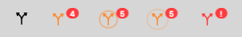

# PRPulse

[](#install)
[](Package.swift)

> A menu bar app that watches one GitHub organization and tells you which pull requests need **you**.

<p align="center">
  <picture>
    <source media="(prefers-color-scheme: dark)" srcset="docs/images/popover-dark.png">
    
  </picture>
</p>

Reviewers leave comments you only see hours later. Open PRs from teammates sit without your review because nothing reminds you. PRPulse polls GitHub every few minutes, keeps two short lists in the menu bar and changes its icon (plus a notification) when something new needs you.

<picture>
  <source media="(prefers-color-scheme: dark)" srcset="docs/images/icons-dark.png">
  
</picture>

Left to right: all clear, something pending, something new (the halo pulses for a few seconds), and an error you need to fix.

## Features

- **My PRs:** open PRs you authored that need an action from you.
- **To review:** every open PR in the organization you haven't reviewed yet, even if nobody requested you.
- **Quiet by design:** bots are ignored, a first run never floods you with old backlog, and an item notifies once.
- **One org at a time**, with a list of repositories to ignore (PRs where you are a requested reviewer, directly or through a team such as CODEOWNERS, still show).
- **Private:** talks only to GitHub with your own token, kept in the macOS Keychain. No server, no analytics.
- English and Portuguese (follows the system language).

## Install

Download `PRPulse-<version>.dmg` from the [releases page](../../releases), drag **PRPulse** to Applications and open it.

> [!IMPORTANT]
> The app is not signed with an Apple Developer ID, so macOS blocks the first launch. Open it once, then go to **System Settings → Privacy & Security**, scroll to the Security section and click **Open Anyway** next to PRPulse. You only do this once. The button appears only after a blocked launch attempt.

Prefer to build it yourself? A locally built app is not quarantined, so there is no prompt:

```bash
git clone https://github.com/felipeferrarini/prpulse && cd prpulse
make install
```

You need macOS 14+ and the Swift toolchain (Xcode or the Command Line Tools).

## First run

A short wizard asks for:

1. **Connection:** reuse your [`gh`](https://cli.github.com) login, or paste a personal token with the `repo` and `read:org` scopes.
2. **Organization** to watch.
3. **Exceptions:** repositories and bot accounts to ignore.
4. **General:** refresh interval, notifications, open at login.

Everything can be changed later from the gear icon in the summary.

> [!NOTE]
> If your organization enforces SAML SSO, authorize the token for it on GitHub, otherwise the icon turns into the error state. The same happens if the organization is renamed or your token can't see it. Classic tokens must include the `repo` scope, or private repositories would never show up.

## What shows up

### My PRs

| Reason | When |
| --- | --- |
| changes requested | a reviewer requested changes |
| open threads | there are unresolved review threads (resolve them to clear) |
| unanswered comment | the last comment from someone else is newer than your last commit and your last comment (approvals with a "LGTM" body don't count) |
| CI failed | a required check is failing (if the repo defines none, any failed check) |
| conflict | the PR can't merge because of conflicts |
| ready to merge | the merge button is enabled |

A PR with several reasons appears once, with the most urgent one highlighted. Your own drafts only show feedback reasons.

### To review

Open PRs from other people in the organization where you have no submitted review. Drafts appear last, labeled. A PR leaves the list as soon as you submit a review, and doesn't come back when new commits arrive.

## Known limits

- One organization at a time.
- Sign-in through the browser is not available yet; use `gh` or a token.
- The app is signed ad hoc, so after each update macOS may ask again whether PRPulse can read its Keychain item. Choose **Always Allow**; if you deny it, the icon shows the sign-in error.

## Development

```bash
make test      # unit tests (Swift Testing)
make app       # universal, ad-hoc signed build/PRPulse.app
make dmg       # build/PRPulse-<version>.dmg
```

`PRPulseCore` holds all the rules and the GitHub client as pure, tested code; `PRPulse` is the SwiftUI shell. Run the app with fake data using `PRPULSE_DEMO=pending|fresh|empty|error|unconfigured`, and render screenshots with `PRPULSE_SNAPSHOT_DIR=/some/folder`.

> [!TIP]
> With only the Command Line Tools installed, use `scripts/test.sh` (what `make test` runs). Plain `swift test` can lose the Swift Testing macro plugin on incremental builds.

## Português

O PRPulse é um app de barra de menu que acompanha uma organização do GitHub e mostra duas listas: **Minhas PRs** (pediu alterações, threads abertas, comentário sem resposta, CI falhou, conflito, pronta para merge) e **Para revisar** (PRs abertas de outras pessoas sem review seu). O ícone muda de cor e o app notifica quando aparece algo novo.

Instalação: baixe o `.dmg` nas releases, arraste para Aplicativos e abra. Como o app não é assinado, na primeira vez vá em **Ajustes do Sistema → Privacidade e Segurança** e clique em **Abrir Mesmo Assim**. Ou rode `make install` para compilar localmente, sem esse passo.
