<p align="center">
  
</p>

<h1 align="center">PRPulse</h1>

<p align="center">
  <b>Know which pull requests need you, before anyone has to ask.</b><br>
  A native menu bar app for macOS that watches your GitHub organizations and tells you what to act on.
</p>

<p align="center">
  <a href="https://github.com/felipeferrarini/prpulse/releases/latest"></a>
  <a href="#install"></a>
  <a href="Package.swift"></a>
  <a href="#install"></a>
  <a href="LICENSE"></a>
</p>

<p align="center">
  <a href="#install">Install</a> ·
  <a href="#what-you-get">What you get</a> ·
  <a href="#review-with-ai">Review with AI</a> ·
  <a href="#what-counts-as-needs-you">What counts</a> ·
  <a href="#privacy">Privacy</a> ·
  <a href="#development">Development</a> ·
  <a href="README.pt-BR.md">Português</a>
</p>

<p align="center">
  <picture>
    <source media="(prefers-color-scheme: dark)" srcset="docs/images/hero-dark.png">
    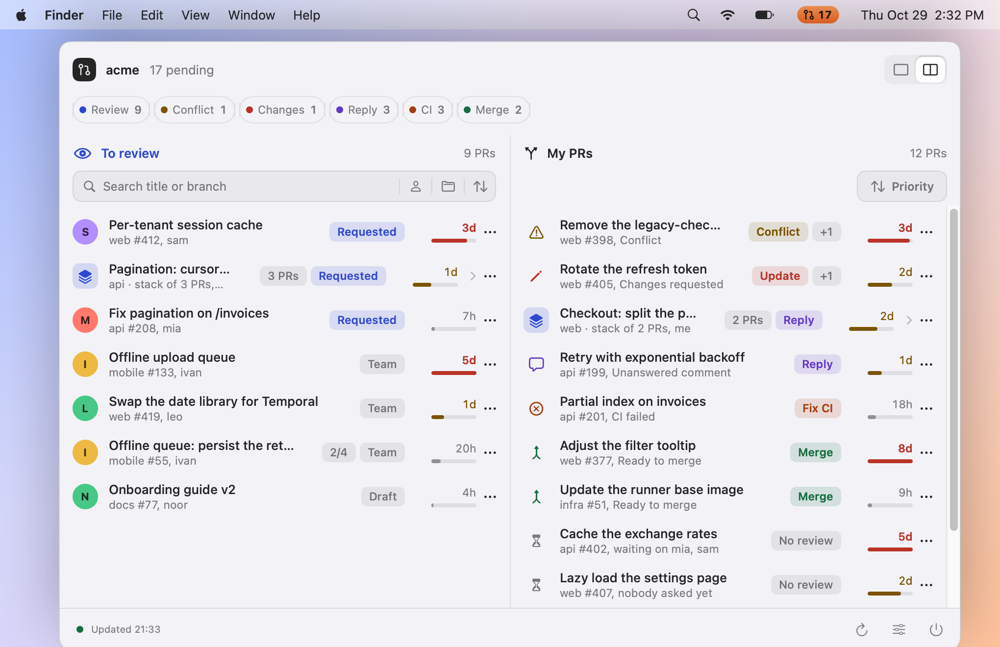
  </picture>
</p>

## Why

Reviewers leave comments you only notice hours later. Teammates open PRs that sit for days because nothing reminds you to look. And "what do I need to do today?" means opening five GitHub tabs.

PRPulse polls GitHub every few minutes, keeps **two short lists** in your menu bar, and changes its icon (plus one notification) the moment something new needs you. It is built around a single question: *what is waiting on me?*

## What you get

### Two lists, ordered by what to do first

**To review** has every open PR of someone else in the organization, the ones you already reviewed too. By default the ones that wait for you come first (those that requested you, then those nobody has reviewed yet), then the ones you reviewed (the mergeable first), then drafts. A small warning marks any PR that has a merge conflict. Each row shows how long it has been waiting, in amber after a day and red after three. Only the ones that wait for your review count in the icon and in the notifications. **My PRs** has all of your own open PRs, the most urgent first: a *Conflict*, then what needs an answer (*Update*, *Reply*), then *Fix CI* and *Merge*, then the ones nobody has reviewed yet, the ones in review, and drafts. Each is tagged with the verb that clears it. Only the ones that ask something of you count in the icon.

Tap the action filters to dim everything else, or switch between a single view and a side by side one. The choice is remembered.

A PR nobody has reviewed has a *Copy link* button (on hover), so you can nudge the right person.

Every list has a sort menu: priority (the default), oldest first, newest first, recent activity, project and, for the PRs to review, author. The choice is remembered. In **To review** you can also search the title and the branch, and filter by author and by project; those reset every time the popover opens.

Every row has a **⋯** menu: open on GitHub, copy the link and, on the review list, *Review with…* and *Mute this repository* so it stops showing without opening Settings.

Pull requests in a GitHub **stack** are put together in one row, and you can tick several to review at once; see [Stacks, and several pull requests at once](#stacks-and-several-pull-requests-at-once).

<table>
  <tr>
    <td width="50%" align="center">
      <picture>
        <source media="(prefers-color-scheme: dark)" srcset="docs/images/popover-dark.png">
        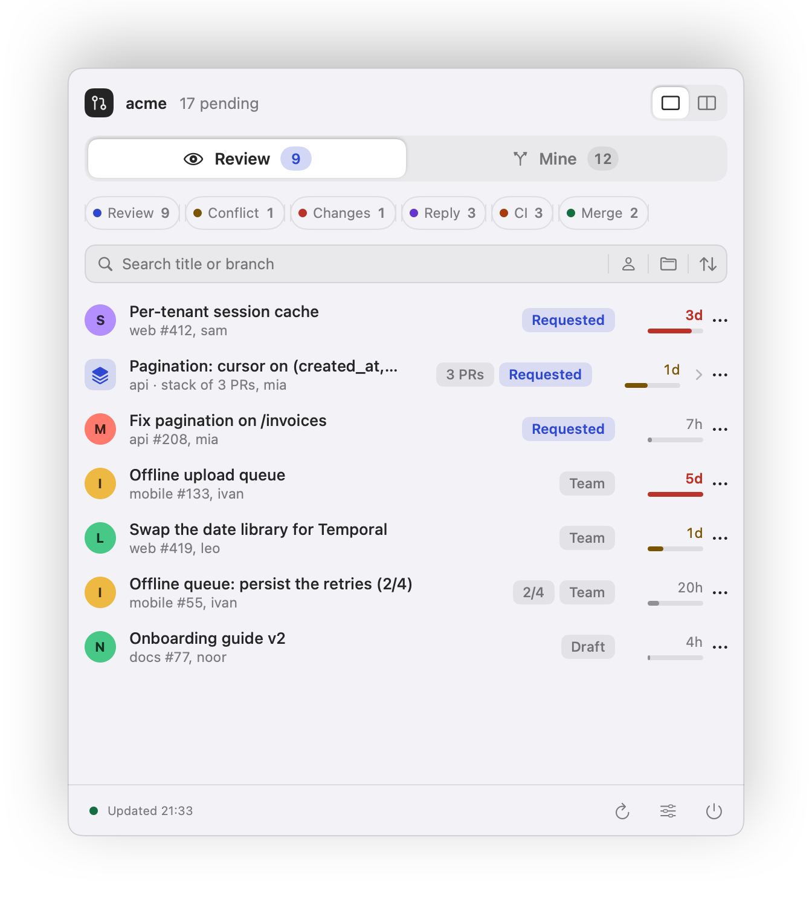
      </picture>
      <br><sub>Single view, with a tab for each list</sub>
    </td>
    <td width="50%" align="center">
      <picture>
        <source media="(prefers-color-scheme: dark)" srcset="docs/images/popover-split-dark.png">
        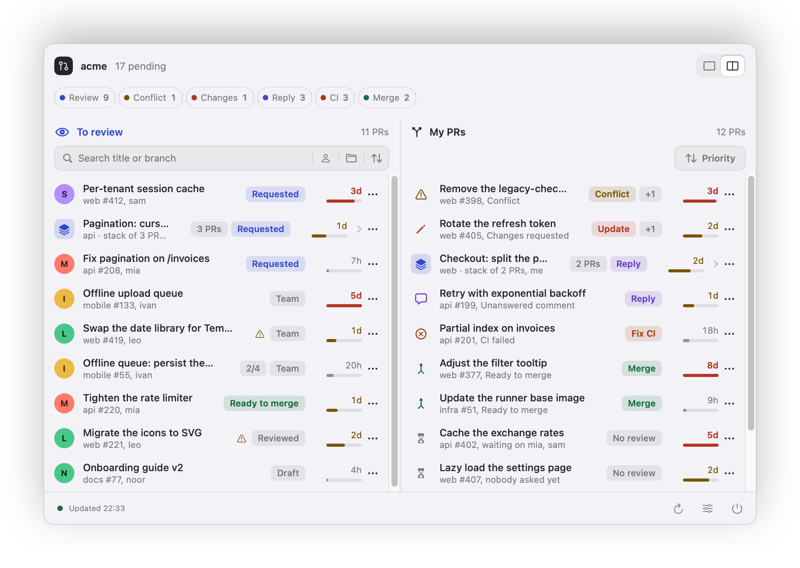
      </picture>
      <br><sub>Side by side, both lists at once</sub>
    </td>
  </tr>
</table>

### An icon that tells you before you look

The menu bar icon is a drawn pull request mark. When everything is clear it is a plain glyph that follows your menu bar theme. When something needs you it becomes one orange pill with the count, rings out when a new item arrives, and turns red if it can't update.

<p align="center">
  <picture>
    <source media="(prefers-color-scheme: dark)" srcset="docs/images/menubar-dark.png">
    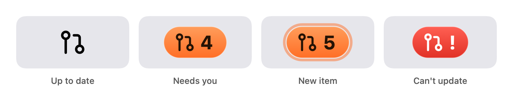
  </picture>
</p>

### A menu one right click away

Right click (or control click) the icon for the things you do without opening the popover.

<table>
  <tr>
    <td width="320">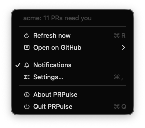</td>
    <td>
      <ul>
        <li><b>Refresh now</b> (⌘R) instead of waiting for the next cycle.</li>
        <li><b>Open on GitHub</b> jumps to a search already filtered to your organization: PRs to review, or your PRs.</li>
        <li><b>Notifications</b> is a quick mute that doesn't need the settings window.</li>
        <li><b>Settings…</b> (⌘,), <b>About</b> and <b>Quit</b>.</li>
      </ul>
    </td>
  </tr>
</table>

### Set up in a minute

A short wizard connects your account, picks the organizations, asks what to leave out and how you want to be told, where reviews open, and which mascot lives on your screen. A live preview of the popover on the left reacts to every choice, so you see the effect of ignoring a repository before you finish.

<p align="center">
  <picture>
    <source media="(prefers-color-scheme: dark)" srcset="docs/images/wizard-dark.png">
    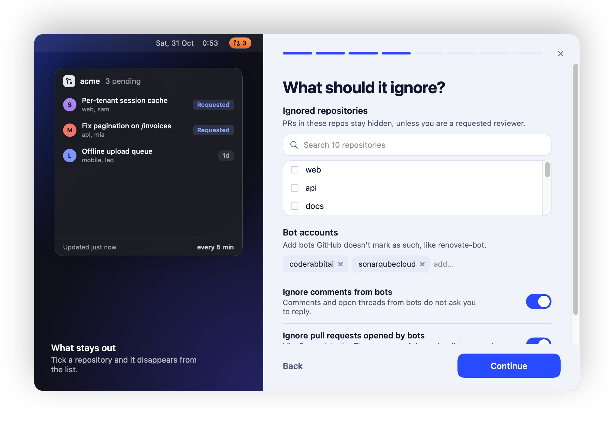
  </picture>
</p>

Everything can be changed later in **Settings**, which counts your unsaved changes, marks the section they are in, and lets you discard them or save with ⌘S. A **What's new** page there lists what changed in each version, and after an update a window shows what is new once (you can turn that off).

<p align="center">
  <picture>
    <source media="(prefers-color-scheme: dark)" srcset="docs/images/news-dark.png">
    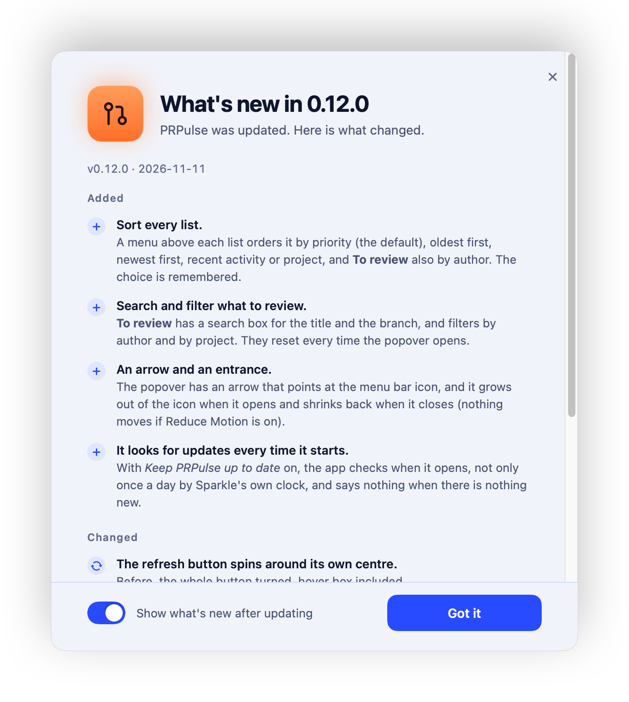
  </picture>
</p>

While the wizard or Settings is open, PRPulse shows in the Dock and in the app switcher (⌘Tab), so you can find the window again after another app takes the front. It goes back to the menu bar alone when the last window closes.

<p align="center">
  <picture>
    <source media="(prefers-color-scheme: dark)" srcset="docs/images/settings-dark.png">
    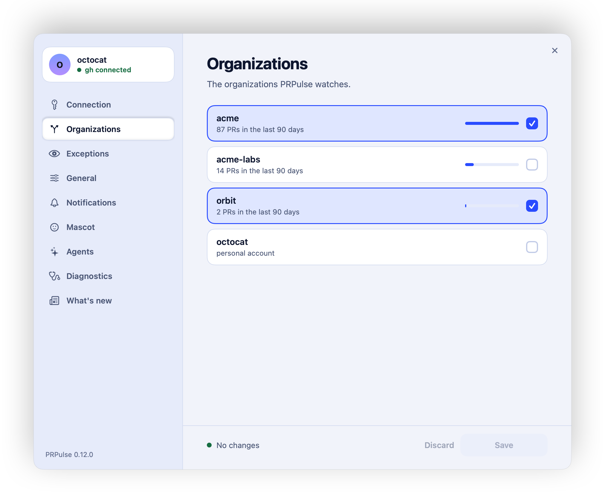
  </picture>
</p>

### A mascot in the corner

A little friend lives in the bottom right corner of your screen and reacts to what is going on. Drag it anywhere, click it to open the panel, right click it to change its character or size. It is on by default (turn it off in Settings or from the menu bar icon) and never takes the focus.

<p align="center">
  <picture>
    <source media="(prefers-color-scheme: dark)" srcset="docs/images/mascots-dark.png">
    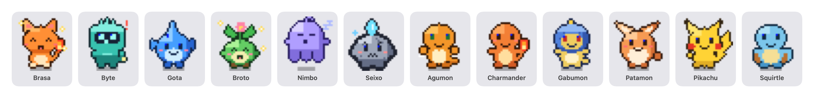
  </picture>
</p>

| Situation | The mascot |
| --- | --- |
| Nothing to do | calm, and asleep after half an hour of quiet |
| Something needs you | alert, with the count on its shoulder |
| A new item arrived | jumps for joy and says it in a bubble, next to the system notification |
| A request, or one of your PRs, waits for 3 days or more | worried, with a sweat drop |
| Refreshing | thinking |
| Can't reach GitHub | sad |

Six characters come with the app. To add your own, drop a folder with a `sprites.png` sheet and a `mascot.json` into `~/Library/Application Support/PRPulse/Mascots/` (Settings → Mascot has a button that opens it). The sheet has one row per mood and one column per frame:

```json
{
  "name": "My critter",
  "frame": { "width": 32, "height": 32 },
  "fps": 8,
  "states": {
    "calm": { "row": 0, "frames": 4 },
    "alert": { "row": 1, "frames": 4 },
    "joy": { "row": 2, "frames": 6 }
  }
}
```

The moods are `calm`, `sleep`, `alert`, `joy`, `worried`, `think`, `sad` and `nudged`. Only `calm` is required; a mood you leave out plays `calm`, except `nudged`, which plays `alert` first. `make mascots` redraws the built-in ones.

### Review with AI

On a pull request to review, the `⋯` menu (and a right click) has **Review with …**, with the destination you chose first and the others under **Review with…**. PRPulse does not run the review: it takes the pull request to the app or the terminal where you already work, with the request, the folder and the skill in place, and you go on from there with all the features of that app (approving commands, choosing the model, commenting on the pull request).

| Destination | How it opens | Starts by itself |
| --- | --- | --- |
| **Claude Desktop** | a new Code session, with the request and the folder (`claude://code/new`) | no, you press Enter |
| **Codex** (app) | a new chat, with the request and the folder as its workspace (`codex://threads/new`) | no, you press Enter |
| **Cursor** (app) | opens the repository in Cursor, then the request in its chat | no, you press Enter |
| **Claude Code**, **Codex**, **Cursor Agent** (terminal) | a terminal in the repository's folder running `claude`, `codex` or `agent` with the request | yes |
| **Custom command** | the command you write, in a terminal | yes |

- **The terminal is yours.** Terminal destinations open a `.command` script with the system default, which is the app macOS uses for that kind of file (Terminal unless you changed it). Settings → Agents → **Terminal** lets you pick another one (iTerm, Ghostty and Warp are listed when installed, and **Other app…** takes any app). If an app does not run `.command` files, use a custom command.
- **A custom command** can use `{prompt}`, `{url}`, `{urls}`, `{repo}`, `{number}` and `{folder}`; each goes in as one quoted word, so nothing a pull request says can become part of the command, and the request is added at the end when `{prompt}` is not there.
- **The request.** It holds the pull request's address, the focus (performance, security, code and project conventions) and a note not to post anything on GitHub unless you ask. Only the address and number go in, never the title or description, which other people wrote. If you have a review skill under `~/.claude` or in a plugin, the Claude destinations name it; Settings → Agents lets you pick a skill and edit the text (`{url}`, `{urls}`, `{repo}`, `{number}` and `{skill}` are filled in).
- **The folder.** The session opens in the clone of the repository (PRPulse looks in your usual folders and asks when it cannot find one), or in the **default project** of the organization if you set one: handy when you keep all of an organization's projects under one root folder and run your sessions there. Cursor's link has no folder, so its window is opened on the folder first.
- **Limits of links.** An app link only fills in the message. Claude Desktop always asks you to confirm a folder that comes from a link, and a request that starts with `/` or is too long for a link (about 8,000 characters) is refused with a note instead of being cut.

### Stacks, and several pull requests at once

Pull requests in a [GitHub stack](https://docs.github.com/en/pull-requests/get-started/about-stacked-prs) are put together in one row, with a layers icon, how many there are, and a `1/3` on each of them. Click the row and the list becomes that stack, bottom first, with **Review the stack** (one conversation that sees all of them, from the bottom to the top) and, for a terminal destination, **Review each** (one conversation for each). In a list that has only some of a stack, the row says so (`2 of 4 PRs of a stack`). A host that does not have stacks, such as GitHub Enterprise Server, shows the plain list.

For pull requests that belong together without being a stack, for example one in each repository of the same feature, **Select** (above the list) puts a checkbox on every row. Tick the ones you want, a stack ticks all of its pull requests, then choose **Review together** or, for a terminal destination, **Review each**. A review of several repositories opens in the first one's folder.

<table>
  <tr>
    <td width="50%" align="center">
      <picture>
        <source media="(prefers-color-scheme: dark)" srcset="docs/images/stack-dark.png">
        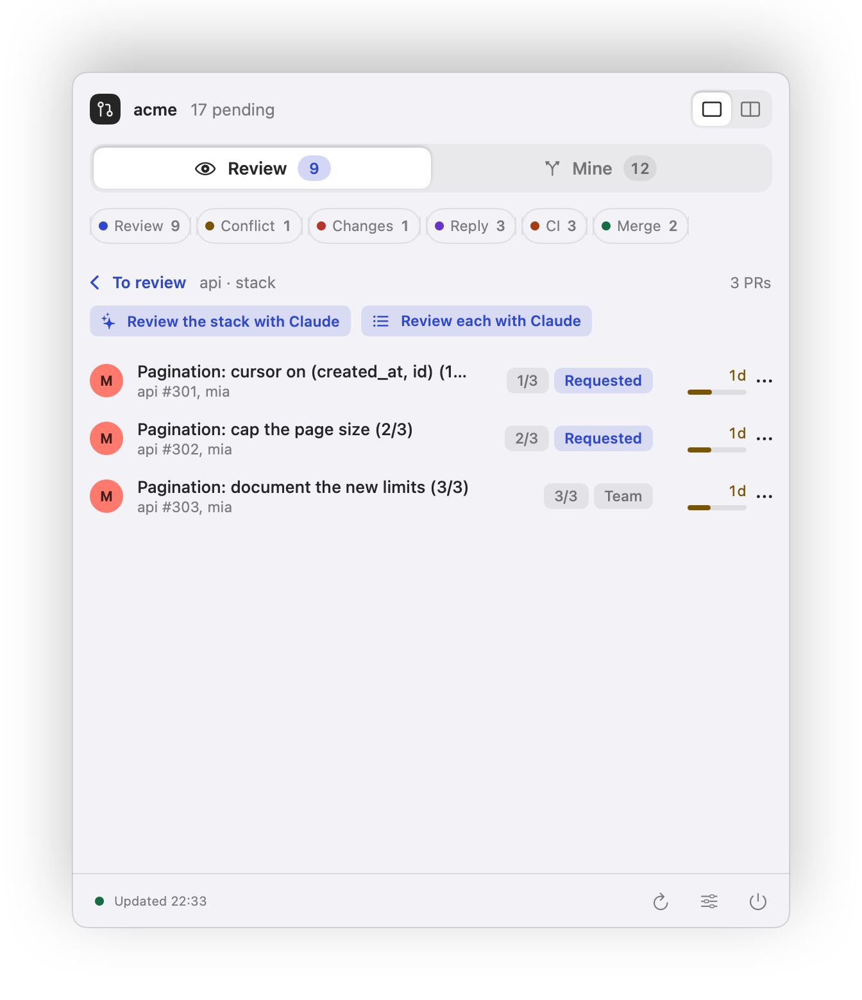
      </picture>
      <br><sub>A stack, open: only its pull requests</sub>
    </td>
    <td width="50%" align="center">
      <picture>
        <source media="(prefers-color-scheme: dark)" srcset="docs/images/batch-dark.png">
        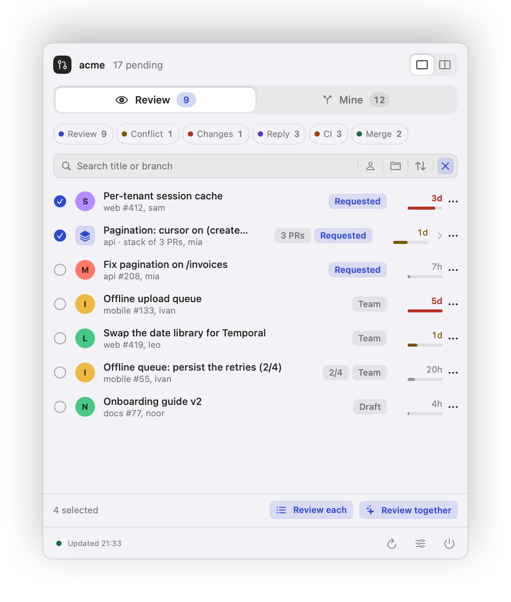
      </picture>
      <br><sub>Several ticked, from any repository</sub>
    </td>
  </tr>
</table>

### Nudge

Two nudges, both started from the right click menu of a pull request. On the other person's Mac the mascot jumps and shakes, a sound plays and a notification shows. It is meant to be noticed, so it has rules.

**To get a review.** On a pull request of yours that lacks reviews, **Nudge** lists anyone on the team (whoever shows up in the pull requests PRPulse reads) who has not reviewed it. People who took part in it stay listed once you pushed a commit after their last activity.

**To merge.** On a pull request of someone else that you reviewed and that already has the reviews it needs, **Tell rita it can be merged** nudges its author. Only the reviews are looked at: failing checks or a conflict do not stop it. If the repository asks for no reviews, your own approval is what counts.

- **A budget per person and per pull request.** At least three hours between nudges to the same person about the same pull request, and at most three, each stronger than the last: the sound plays once, then twice, then three times. Nudging the same person about another pull request starts over. The menu is the same people with their reasons when one is not allowed yet.
- **A line of your own, or none.** **Nudge** is one click per person. **Nudge with a message…** adds up to 140 characters, which show in the notification and in a comment on the pull request, where everyone can read them.
- **It stops when it is done.** The mascot stays restless until they open the pull request, and a second notification comes after 15 minutes if they have not. The nudge arrives on their next refresh, so it can take up to their refresh interval (1 to 30 minutes).

It goes through GitHub: a nudge to get a review asks for the review again and leaves a comment with a hidden marker; a nudge to merge only leaves the comment. People who do not use PRPulse see an ordinary mention. It needs no server, and the nudge is the only thing PRPulse ever writes to GitHub.

On the receiving side it is on by default (Settings → **Notifications**: **React to nudges** and **Nudge sound**). The mascot's right click menu has **Pause nudges**, for an hour or until tomorrow morning. The sound is Sosumi unless you pick another: the **Sound** row in the same page lists the macOS sounds and has a play button. To use your own, click **Open the sounds folder** and drop a `.wav`, `.caf`, `.aiff`, `.m4a` or `.mp3` file in it (`~/Library/Application Support/PRPulse/Sounds`); it shows up in the list, and anything over three seconds is cut short. If the file goes away, Sosumi plays.

### Quiet by design

- **Bots stay out of the way.** Comments from CodeRabbit, SonarQube and any account GitHub marks as a bot don't ask you to reply, and you can add the accounts GitHub does not mark. Two switches decide what to ignore: their comments (on by default) and the PRs they open, like Dependabot's, which stay out of the review list (both on by default).
- **No flood on day one.** The first run learns what is already pending and stays silent. An item notifies once.
- **One organization or several**, with a list of repositories to ignore. A PR in an ignored repository still shows if you are a requested reviewer, directly or through a team such as CODEOWNERS.
- **A global shortcut**, ⌥⌘P, opens and closes the panel from anywhere.
- **Updates itself.** It checks for new versions and installs them in the background (you can turn that off in Settings).
- English and Portuguese, following your system language.

## Install

### Homebrew

```bash
brew tap felipeferrarini/tap
brew trust felipeferrarini/tap
brew install --cask prpulse
```

Recent Homebrew versions refuse to load casks from a third-party tap until you trust it, which is what the `brew trust` line does. Older versions don't have that command; skip it there.

### Download

Get `PRPulse-<version>.dmg` from the [releases page](https://github.com/felipeferrarini/prpulse/releases/latest), drag **PRPulse** to Applications and open it.

> [!IMPORTANT]
> The app is not signed with an Apple Developer ID yet, so on the first launch macOS says it "could not be opened". Click **OK** (not "Move to Trash"), then go to **System Settings → Privacy & Security**, scroll to the Security section and click **Open Anyway** next to PRPulse. The button only shows up after a blocked launch attempt, and only for about an hour.
>
> Prefer the terminal? This does the same:
>
> ```bash
> xattr -dr com.apple.quarantine /Applications/PRPulse.app
> ```
>
> It is a first install thing: the automatic updates should not ask again.

### Build it yourself

A locally built app is not quarantined, so there is no prompt:

```bash
git clone https://github.com/felipeferrarini/prpulse && cd prpulse
make install
```

You need macOS 14 or later and the Swift toolchain (Xcode or the Command Line Tools). Builds are universal (Apple silicon and Intel).

## First run

1. **Connection:** reuse your [`gh`](https://cli.github.com) login, or paste a personal token with the `repo` and `read:org` scopes. Without a login, **Sign in with GitHub** runs `gh auth login` for you (it shows the code, copies it and opens the page), and **Generate token on GitHub** opens the token page with the scopes already ticked.
2. **Organizations:** pick one or more. The ones you worked in most over the last 90 days come first, with a count.
3. **Exceptions:** tick repositories to ignore (they are listed from the organization) and edit the bot accounts to skip.
4. **Settings:** refresh interval, notifications, open at login.
5. **Reviews with AI:** turn them on and choose where they open (Claude Desktop, Codex, Cursor, a terminal or your own command).
6. **Mascot:** pick the character that lives in the corner of your screen, or turn it off.

> [!NOTE]
> If your organization enforces SAML SSO, authorize the token for it on GitHub, otherwise the icon turns into the error state. The same happens if the organization is renamed or your token can't see it. Classic tokens must include the `repo` scope, or private repositories would never show up.

## Sign in with your team's OAuth App

For a team, the easiest sign-in is an OAuth App that someone registers once. Everybody else signs in from the browser with no token and no `gh`. The app's Client ID is public (the device flow needs no secret), so it is safe to share.

1. An owner of your organization opens **Settings → Developer settings → OAuth Apps → New OAuth App** (on the organization, so it is trusted by it from the start).
2. Fill in a name (PRPulse), the homepage (this repository) and any callback URL, such as `http://localhost`. Tick **Enable Device Flow**, register the app, and copy the **Client ID**. Do not generate a client secret; PRPulse never uses one.
3. Everyone else picks **Sign in with the browser** (in the setup or in Settings → Connection), pastes the Client ID and clicks the button. PRPulse shows a code, opens github.com/login/device, and keeps the token in the Keychain.

To roll it out to a whole team, set the Client ID in the app's preferences and the field comes filled in:

```bash
defaults write io.github.felipeferrarini.prpulse OAuthClientID -string "Iv1.0123456789abcdef"
```

A configuration profile (MDM) can set the same `OAuthClientID` key for that domain. An app owned by a person, instead of the organization, may need an owner's approval when the organization restricts third-party apps. The sign-in asks for the `repo` and `read:org` scopes.

## What counts as "needs you"

### My PRs

| Action | When it shows |
| --- | --- |
| **Conflict** | the PR can't merge because of conflicts |
| **Update** | a reviewer requested changes |
| **Reply** (open threads) | there are unresolved review threads; resolve them to clear |
| **Reply** (comment) | the last comment from someone else is newer than your last commit and your last comment (approvals with an "LGTM" body don't count) |
| **Fix CI** | a required check is failing (if the repository defines none, any failed check) |
| **Merge** | the merge button is enabled |

A PR with several reasons appears once, with the most urgent one highlighted and a `+1` for the rest, in the order above. Your own drafts only show feedback reasons.

### To review

Every open PR from other people in the organization, in this order by default: requests to you, PRs nobody has reviewed yet, PRs you reviewed that can be merged, PRs you reviewed that cannot yet, and drafts; the oldest wait first within each. Only the first two groups need you, so only they count in the icon and in the notifications. A PR you reviewed stays in the list (tagged *Reviewed*, or *Ready to merge* when it can go), and it needs you again only if you are asked for a new review. A PR with a merge conflict has a small warning.

### Waiting time

Every row shows how long the PR has been open: neutral under a day, amber from one day, red from three. The little bar fills over four days.

## Privacy

- PRPulse talks **only to GitHub** (`api.github.com` and `github.com`) with your own credentials. There is no server of ours, no analytics and no telemetry.
- A personal token is stored in the **macOS Keychain**. With the `gh` option, the token is read from `gh` on demand and never stored by PRPulse.
- **Review with AI** only opens an app or a terminal on your Mac. PRPulse sends nothing anywhere for it: the PR's address and number go in the request, and what the app does with it follows its own terms. The request is written to a temporary `.command` file for the terminal destinations, which PRPulse deletes after an hour.
- The only thing PRPulse writes to GitHub is a **nudge**, and only when you ask for one: a comment on a pull request and, when the nudge is to get a review, a request for a new review from that person. Nothing else is created, edited or deleted.
- Update checks read one small feed file from your releases page on `github.com`. Nothing about you or your Mac is sent.
- Updates are signed with a key only the maintainer holds, and the app refuses anything that doesn't match.
- The app is open source (MIT), so all of this is checkable.

## Settings at a glance

| Section | What you can change |
| --- | --- |
| **Connection** | `gh` login or a personal token |
| **Organizations** | which organizations to watch |
| **Exceptions** | repositories to ignore, your list of bot accounts, and two switches: ignore comments from bots, ignore PRs opened by bots |
| **Mascot** | show it or not, which character, its size, where it sits, and your own characters |
| **Notifications** | alerts for new pull requests, and for nudges: react or not, play a sound or not, which sound (a macOS one, or a file in the sounds folder) |
| **Agents** | turn "Review with AI" on or off, choose where reviews open and which terminal runs the commands, write a custom command, pick the review skill, set a default project folder per organization, edit the request, and the folders chosen for single repositories |
| **General** | refresh interval (1 to 30 minutes), popover layout, open at login, global shortcut, automatic updates, run the setup again |
| **Diagnostics** | version, last sync, GitHub request budget, and a button that copies all of it for a bug report (no token, organization or PR names) |
| **What's new** | what changed in each version of PRPulse, from the changelog that ships with the app |

## Known limits

- Sign-in through the browser is not available yet; use `gh` or a token.
- The app is signed ad hoc, so after each update macOS may ask again whether PRPulse can read its Keychain item. Choose **Always Allow**; if you deny it, the icon shows the error state.
- Review with AI needs the app or the command you chose installed. *Review each* needs a terminal destination, because an app link only fills in one message at a time.
- Stacks come from GitHub's own stacked pull requests. On a host without them, such as GitHub Enterprise Server, every pull request shows on its own row.
- Versions before 0.3.0 don't update themselves: install the latest once, by hand or with `brew upgrade`.

## Development

```text
Sources/PRPulseCore   rules, notification planner, auth, and the provider seam with its GitHub implementation (pure, tested)
Sources/PRPulse       the macOS shell: status item, popover, wizard, settings
Tests/                300+ unit tests (Swift Testing)
scripts/              build, dmg, icon and test helpers
docs/images/          the pictures above, generated by `make screenshots`
```

```bash
make test         # unit tests
make app          # universal, ad-hoc signed build/PRPulse.app
make dmg          # build/PRPulse-<version>.dmg
make install      # build and copy to /Applications
make screenshots  # re-render docs/images with fake data (English UI)
make release      # DMG plus the signed update feed (build/feed/appcast.xml)
```

Run the app with fake data using `PRPULSE_DEMO=pending|fresh|empty|error|unconfigured|many`. To iterate on the interface without a GitHub account, that is all you need.

> [!TIP]
> With only the Command Line Tools installed, use `scripts/test.sh` (what `make test` runs). Plain `swift test` can lose the Swift Testing macro plugin on incremental builds.

## Roadmap

Ideas, in no particular order. Open an issue if one matters to you.

- [ ] Developer ID signing and notarization, so there is no "Open Anyway" step
- [ ] Sign in with GitHub in the browser (device flow)
- [ ] Snooze a PR for a while, not only mute its repository
- [ ] A shortcut you can change
- [ ] A limit for how many background reviews run at once

## Contributing

Issues and pull requests are welcome; see [CONTRIBUTING](CONTRIBUTING.md). Keep the rules in `PRPulseCore` covered by tests, and run `make test` before opening a PR. To report a vulnerability, read [SECURITY](SECURITY.md). For a visual change, attach a before and after picture (`PRPULSE_DEMO` makes that easy).

## License

[MIT](LICENSE) © Felipe Ferrarini
