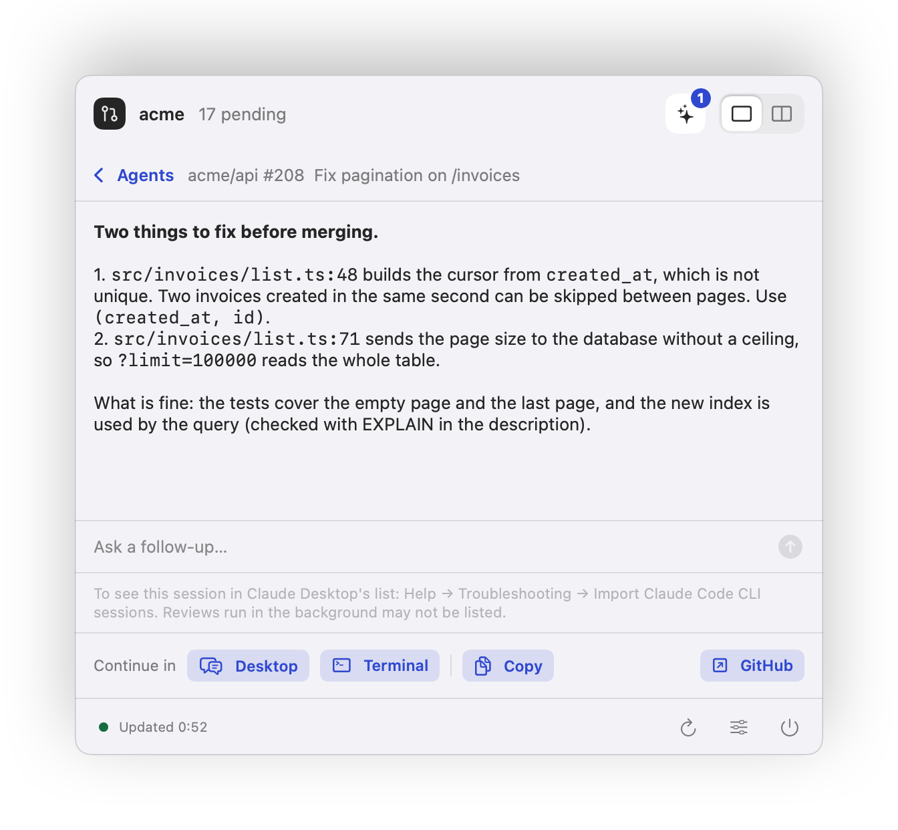
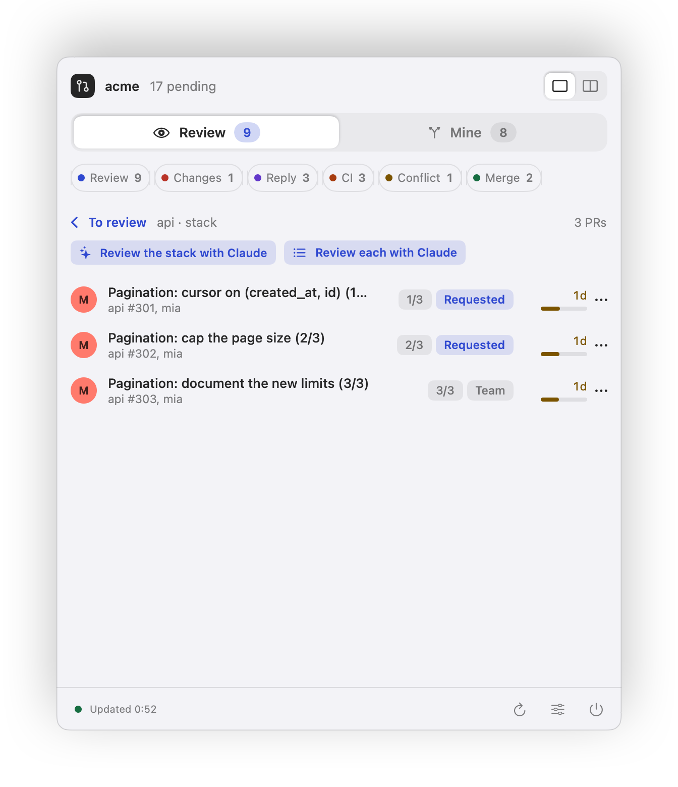
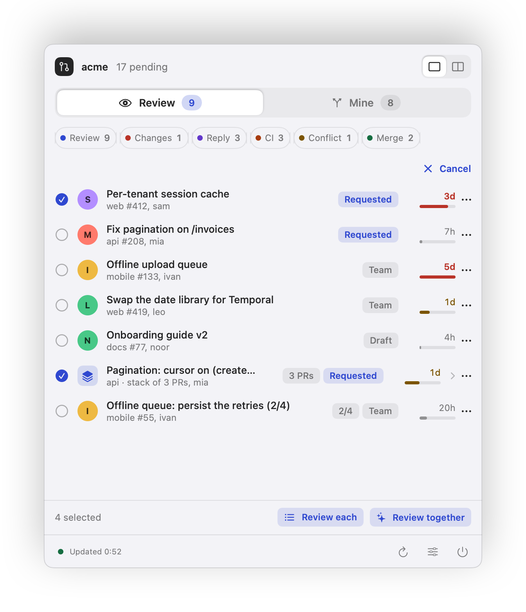
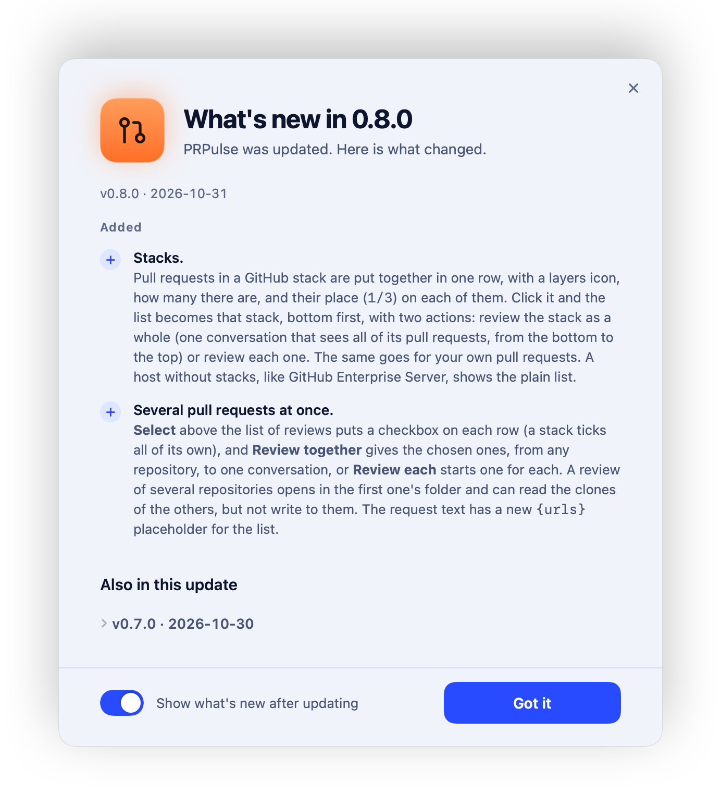

<p align="center">
  
</p>

<h1 align="center">PRPulse</h1>

<p align="center">
  <b>Saiba quais pull requests precisam de você, antes que alguém precise cobrar.</b><br>
  Um app nativo de barra de menu para macOS que acompanha as suas organizações do GitHub e mostra o que exige uma ação sua.
</p>

<p align="center">
  <a href="README.md">English</a> ·
  <a href="#instalação">Instalação</a> ·
  <a href="#o-que-você-recebe">O que você recebe</a> ·
  <a href="#o-que-conta-como-precisa-de-você">O que conta</a> ·
  <a href="#privacidade">Privacidade</a> ·
  <a href="#desenvolvimento">Desenvolvimento</a>
</p>

<p align="center">
  <picture>
    <source media="(prefers-color-scheme: dark)" srcset="docs/images/hero-dark.png">
    
  </picture>
</p>

> [!NOTE]
> Os prints estão com a interface em inglês. O app segue o idioma do sistema e está disponível em português.

## Por quê

Reviewers deixam comentários que você só vê horas depois. Colegas abrem PRs que ficam dias sem review porque nada lembra você de olhar. E "o que eu preciso fazer hoje?" vira abrir cinco abas do GitHub.

O PRPulse consulta o GitHub a cada poucos minutos, mantém **duas listas curtas** na barra de menu e troca o ícone (mais uma notificação) assim que algo novo precisa de você. Ele gira em torno de uma pergunta: *o que está esperando por mim?*

## O que você recebe

- **Para revisar:** toda PR aberta da organização que você ainda não revisou, mesmo que ninguém tenha pedido. As que pediram você vêm primeiro, e cada linha mostra há quanto tempo a PR espera (âmbar depois de 1 dia, vermelho depois de 3).
- **Minhas PRs:** as suas PRs que exigem uma ação, cada uma com o verbo que resolve: *Ajustar*, *Responder*, *Corrigir CI*, *Conflito*, *Merge*.
- **Filtros por ação** e dois layouts, visão única ou lado a lado. A escolha fica salva.
- **Esperando review:** uma seção mais discreta em *Minhas PRs* com as suas PRs que passaram alguns dias (você escolhe quantos) sem nenhum review. Elas não pedem nada de você e não mudam o ícone, mas cada uma tem o botão *Copiar link* para você cobrar a pessoa certa.
- **Menu ⋯ em cada linha:** abrir no GitHub, copiar o link e, na lista de revisão, *Revisar com o Claude* e *Silenciar o repositório*, sem abrir os Ajustes.
- **Uma ou várias organizações**, e um **atalho global**, ⌥⌘P, que abre e fecha o painel de qualquer lugar.
- **Um ícone que avisa antes de você olhar:** um glifo de pull request que acompanha o tema da barra quando está tudo em dia, vira uma pílula laranja com o número quando algo precisa de você, faz um anel de pulso quando chega um item novo e fica vermelho se não conseguir atualizar.
- **Menu do botão direito:** atualizar agora (⌘R), abrir no GitHub (buscas já filtradas pela sua organização), liga/desliga de notificações, Ajustes (⌘,), Sobre e Sair.
- **Assistente de configuração** com prévia ao vivo do popover (conexão, organizações, exceções, frequência, revisão com o Claude e mascote), e uma tela de **Ajustes** que conta as alterações não salvas (⌘S salva) e tem uma aba **Novidades** com o que mudou em cada versão.
- **Um ícone no Dock enquanto uma janela está aberta:** com o assistente ou os Ajustes abertos, o PRPulse aparece no Dock e no ⌘Tab, para você achar a janela de novo depois de outro app passar na frente. Ao fechar a última, ele volta a ficar só na barra de menu.
- **Atualiza sozinho:** busca versões novas e instala em segundo plano (dá para desligar em Ajustes).
- **Um mascote no canto da tela:** um amiguinho no canto inferior direito que reage ao que acontece (alerta, comemora item novo, se preocupa com PR antiga, dorme quando está tudo em dia). Dá para arrastar, trocar de personagem e de tamanho, e adicionar o seu em `~/Library/Application Support/PRPulse/Mascots/`. Vem ligado e dá para desligar em Ajustes ou pelo menu do ícone.
- **Peça ao Claude para revisar uma PR:** nas PRs que esperam o seu review, o menu `⋯` (e o botão direito) tem **Revisar com o Claude**. Precisa do [Claude Code](https://claude.com/claude-code) instalado e logado (rode `claude` uma vez num terminal e use `/login`) e do [`gh`](https://cli.github.com) logado, porque o agente lê a PR com ele.
  - **Em segundo plano:** nada se abre. Um botão `✦` aparece no topo do painel com os reviews em andamento (o que o agente está lendo agora e há quanto tempo) e os já prontos. Uma notificação e o mascote avisam quando um fica pronto.
  - **Perguntar mais:** embaixo de um review pronto há um campo para **perguntar mais** na mesma conversa. *Parar* interrompe uma resposta e mantém o review. Dá para continuar no Claude Desktop ou no Terminal, copiar ou tentar de novo.
  - **Só leitura:** o agente lê o código e a PR por conta própria (`gh pr view`, `gh pr diff`, `git log`…). Em Ajustes → Agentes, **Aprovações** decide o resto. **Automático** (o padrão) usa o [modo automático](https://code.claude.com/docs/en/permission-modes) do Claude Code: o classificador dele decide o que é seguro, então os reviews raramente esperam por você. O PRPulse mantém o review só de leitura por cima disso: os comandos rodam num sandbox em que a pasta do repositório não pode ser escrita e só o GitHub pode ser acessado (`~/.ssh`, `~/.aws` e `~/.gnupg` não podem ser lidos), e editar arquivos, mexer no git ou escrever no GitHub (`gh pr comment`, `gh api`…) é negado. Se o modo automático não estiver disponível para você, o Claude Code pergunta. **Perguntar a mim** deixa o review esperando, com o comando à mostra e uma notificação, até você apertar Permitir ou Negar (uma vez, nunca fica lembrado).
  - **O pedido:** leva o endereço da PR, o foco (performance, segurança, padrão de código e do projeto) e um aviso para não publicar nada no GitHub. Só o endereço e o número vão, nunca o título nem a descrição, que foram escritos por outras pessoas. Se você tem uma skill de review em `~/.claude` ou num plugin, o pedido cita essa skill; em Ajustes → Agentes dá para escolher a skill e editar o texto (`{url}`, `{urls}`, `{repo}`, `{number}` e `{skill}` são preenchidos).
  - **A pasta:** a sessão abre na pasta do clone do repositório (o PRPulse procura nas suas pastas de sempre e pergunta quando não acha) ou, se você definir um **projeto padrão** para a organização, nessa pasta: útil quando você guarda todos os projetos de uma organização sob uma pasta raiz e roda as suas sessões ali.
  - **Claude Desktop:** sem o Claude Code, ou pelo segundo item do menu, **Abrir rascunho no Claude Desktop** abre uma sessão com o pedido já escrito (você aperta Enter para enviar). Um review feito em segundo plano não aparece sozinho na lista do Claude Desktop; *Help → Troubleshooting → Import Claude Code CLI sessions* lá pode trazê-lo, e uma nota embaixo de cada review avisa isso.
  - Cursor e Codex estão nos planos.
- **Stacks e várias PRs de uma vez:** as PRs de uma [stack do GitHub](https://docs.github.com/pt/pull-requests/get-started/about-stacked-prs) aparecem juntas numa linha só, com um ícone de camadas, quantas são e um `1/3` em cada uma. Ao clicar, a lista vira a stack, da base ao topo, com **Revisar a stack com o Claude** (uma conversa que vê todas, da base ao topo) e **Revisar cada uma com o Claude**. Quando a sua lista tem só algumas PRs de uma stack, a linha diz (`2 de 4 PRs de uma stack`). Num host sem stacks, como o GitHub Enterprise Server, cada PR aparece na sua própria linha.
  - **Várias de uma vez:** para PRs que são da mesma funcionalidade sem ser uma stack, como uma em cada repositório, **Selecionar** (acima da lista) põe uma caixa em cada linha: marque as que quiser, uma stack marca todas as suas PRs, e escolha **Revisar juntas** ou **Revisar cada uma**. Um review de vários repositórios abre na pasta do primeiro e pode ler os clones dos outros (nunca escrever neles).
- **Silencioso por padrão:** os comentários de bots não pedem resposta e as PRs que eles abrem, como as do Dependabot, ficam fora da lista de revisão (dois interruptores em Ajustes, ambos ligados por padrão), a primeira execução não despeja o backlog antigo em notificações e cada item avisa uma vez.

<table>
  <tr>
    <td width="50%" align="center">
      <picture>
        <source media="(prefers-color-scheme: dark)" srcset="docs/images/popover-dark.png">
        
      </picture>
    </td>
    <td width="50%" align="center">
      <picture>
        <source media="(prefers-color-scheme: dark)" srcset="docs/images/wizard-dark.png">
        
      </picture>
    </td>
  </tr>
</table>

<table>
  <tr>
    <td width="33%" align="center">
      <picture>
        <source media="(prefers-color-scheme: dark)" srcset="docs/images/agents-dark.png">
        
      </picture>
      <br><sub>Um review pronto</sub>
    </td>
    <td width="33%" align="center">
      <picture>
        <source media="(prefers-color-scheme: dark)" srcset="docs/images/stack-dark.png">
        
      </picture>
      <br><sub>Uma stack, aberta</sub>
    </td>
    <td width="33%" align="center">
      <picture>
        <source media="(prefers-color-scheme: dark)" srcset="docs/images/batch-dark.png">
        
      </picture>
      <br><sub>Várias marcadas</sub>
    </td>
  </tr>
</table>

## Instalação

### Homebrew

```bash
brew tap felipeferrarini/tap
brew trust felipeferrarini/tap
brew install --cask prpulse
```

Versões recentes do Homebrew não carregam casks de um tap de terceiros até você confiar nele, e é isso que a linha `brew trust` faz. Versões antigas não têm esse comando; pule a linha.

### Download

Baixe o `PRPulse-<versão>.dmg` na [página de releases](https://github.com/felipeferrarini/prpulse/releases/latest), arraste o **PRPulse** para Aplicativos e abra.

> [!IMPORTANT]
> O app ainda não é assinado com um Apple Developer ID, então na primeira abertura o macOS avisa que ele "não foi aberto". Clique em **OK** (não em "Mover para o Lixo"), depois vá em **Ajustes do Sistema → Privacidade e Segurança**, role até a seção de Segurança e clique em **Abrir Mesmo Assim** ao lado do PRPulse. O botão só aparece depois de uma tentativa de abertura bloqueada, e por cerca de uma hora.
>
> Prefere o terminal? Isto faz o mesmo:
>
> ```bash
> xattr -dr com.apple.quarantine /Applications/PRPulse.app
> ```
>
> Isso é só na primeira instalação: as atualizações automáticas não devem pedir de novo.

### Compilar você mesmo

Um app compilado localmente não é colocado em quarentena, então não há esse passo:

```bash
git clone https://github.com/felipeferrarini/prpulse && cd prpulse
make install
```

Você precisa de macOS 14 ou mais novo e do toolchain Swift (Xcode ou as Command Line Tools). O build é universal (Apple silicon e Intel).

## Primeira execução

1. **Conexão:** reaproveite o login do [`gh`](https://cli.github.com) ou cole um token pessoal com os escopos `repo` e `read:org`.
2. **Organizações:** escolha uma ou mais. As que você mais usou nos últimos 90 dias vêm primeiro, com a contagem.
3. **Exceções:** marque repositórios para ignorar (eles são listados a partir da organização) e edite as contas de bot a pular. Ali também há dois interruptores: ignorar comentários de bots e ignorar as PRs que eles abrem.
4. **Ajustes:** frequência de atualização, notificações, abrir ao iniciar o Mac e atualizações automáticas. Em Ajustes há também uma aba de **Diagnóstico**, com um botão que copia as informações para um relato de problema (sem token, nem nomes de organização ou de PR), e a aba **Novidades**, que mostra o que mudou em cada versão; depois de uma atualização, uma janela mostra as novidades uma vez (dá para desligar).
5. **Revisão com o Claude:** ligue ou desligue, veja se o Claude Desktop e o Claude Code estão prontos e escolha quem aprova (Automático ou Perguntar a mim).
6. **Mascote:** escolha o personagem que fica no canto da tela, ou desligue.

<p align="center">
  <picture>
    <source media="(prefers-color-scheme: dark)" srcset="docs/images/news-dark.png">
    
  </picture>
</p>

> [!NOTE]
> Se a sua organização exige SAML SSO, autorize o token para ela no GitHub, senão o ícone vai para o estado de erro. O mesmo acontece se a organização for renomeada ou o token não enxergá-la. Tokens clássicos precisam do escopo `repo`, ou os repositórios privados nunca aparecem.

## O que conta como "precisa de você"

### Minhas PRs

| Ação | Quando aparece |
| --- | --- |
| **Ajustar** | um reviewer pediu alterações |
| **Responder** (threads abertas) | há threads de review sem resolver; resolva para limpar |
| **Responder** (comentário) | o último comentário de outra pessoa é mais novo que o seu último commit e o seu último comentário (aprovações com um "LGTM" no corpo não contam) |
| **Corrigir CI** | um check obrigatório está falhando (se o repositório não define nenhum, qualquer check que falhar) |
| **Conflito** | a PR não pode ser integrada por causa de conflitos |
| **Merge** | o botão de merge está habilitado |

Uma PR com vários motivos aparece uma vez, com o mais urgente em destaque e um `+1` para os demais, na ordem acima. As suas próprias PRs em rascunho só mostram motivos de feedback.

### Para revisar

PRs abertas de outras pessoas na organização em que você não enviou review. Os pedidos a você vêm primeiro, rascunhos por último e as mais antigas esperam na frente. A PR sai da lista assim que você envia um review, e não volta quando chegam commits novos.

## Privacidade

- O PRPulse fala **só com o GitHub** (`api.github.com` e `github.com`), com as suas próprias credenciais. Não há servidor nosso, análise de uso nem telemetria.
- Um token pessoal fica no **Keychain do macOS**. Com a opção `gh`, o token é lido do `gh` na hora e nunca guardado pelo PRPulse.
- **Revisar com o Claude** roda o Claude Code no seu Mac, ou entrega o pedido ao Claude Desktop. O PRPulse não envia nada para lugar nenhum por causa disso: só o endereço e o número da PR vão no pedido, o que o Claude faz com ele segue os termos dele, e um review em segundo plano gasta o seu plano do Claude como qualquer outra sessão. No modo Automático, os comandos rodam num sandbox que não escreve no seu repositório e só alcança o GitHub. Os reviews ficam em `~/Library/Application Support/PRPulse/` (os últimos vinte), e mais nada é guardado.
- A checagem de atualização lê um arquivo pequeno da página de releases em `github.com`. Nada sobre você ou o seu Mac é enviado.
- As atualizações são assinadas com uma chave que só quem mantém o projeto tem, e o app recusa o que não bater.
- O app é código aberto (MIT), então tudo isso pode ser conferido.

## Limites conhecidos

- Entrar pelo navegador ainda não existe; use o `gh` ou um token.
- O app é assinado ad hoc, então depois de cada atualização o macOS pode perguntar de novo se o PRPulse pode ler o item do Keychain. Escolha **Sempre Permitir**; se negar, o ícone mostra o estado de erro.
- A revisão com o Claude precisa do Claude Code e do `gh` logados; Cursor e Codex ainda não são suportados. Vários reviews em segundo plano ao mesmo tempo gastam o seu plano do Claude mais rápido, e *Revisar cada uma* numa stack grande começa um por PR.
- As stacks vêm das PRs empilhadas do próprio GitHub. Num host sem elas, como o GitHub Enterprise Server, cada PR aparece na sua própria linha.
- Versões anteriores à 0.3.0 não se atualizam sozinhas: instale a mais recente uma vez, à mão ou com `brew upgrade`.

## Desenvolvimento

```bash
make test         # testes unitários
make app          # build universal, assinado ad hoc, em build/PRPulse.app
make dmg          # build/PRPulse-<versão>.dmg
make install      # compila e copia para /Applications
make screenshots  # gera de novo as imagens de docs/images com dados fictícios
make release      # DMG mais o feed de atualização assinado (build/feed/appcast.xml)
```

`PRPulseCore` guarda as regras e o cliente do GitHub como código puro e testado; `PRPulse` é a casca do macOS. Rode o app com dados fictícios usando `PRPULSE_DEMO=pending|fresh|empty|error|unconfigured|many`. Veja a seção [Development](README.md#development) do README em inglês para a estrutura completa.

## Contribuindo

Issues e pull requests são bem-vindos. Mantenha as regras do `PRPulseCore` cobertas por testes e rode `make test` antes de abrir uma PR.

## Licença

[MIT](LICENSE) © Felipe Ferrarini
