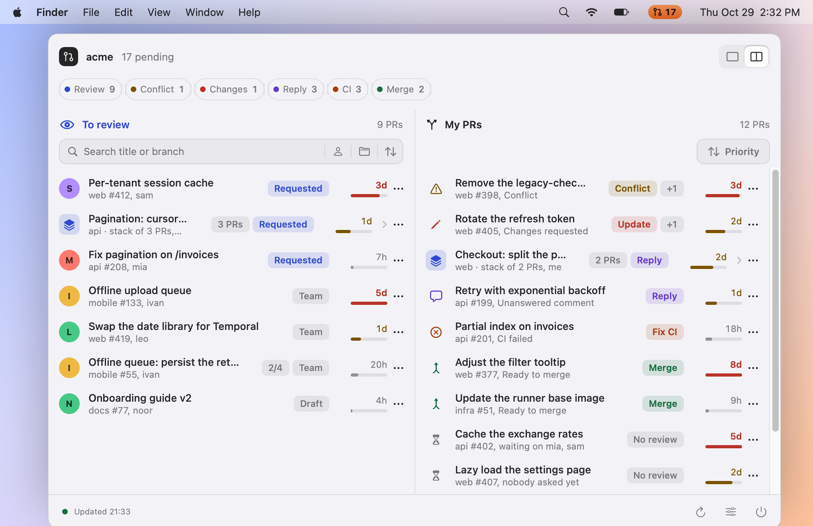
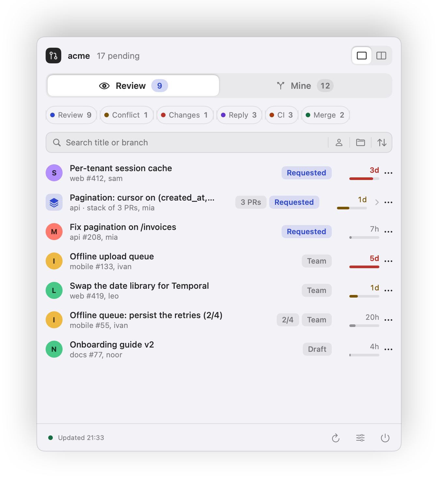
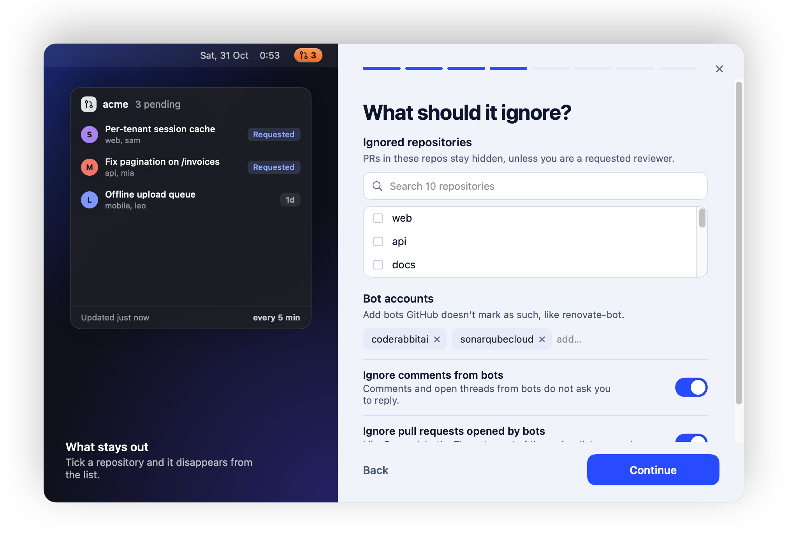
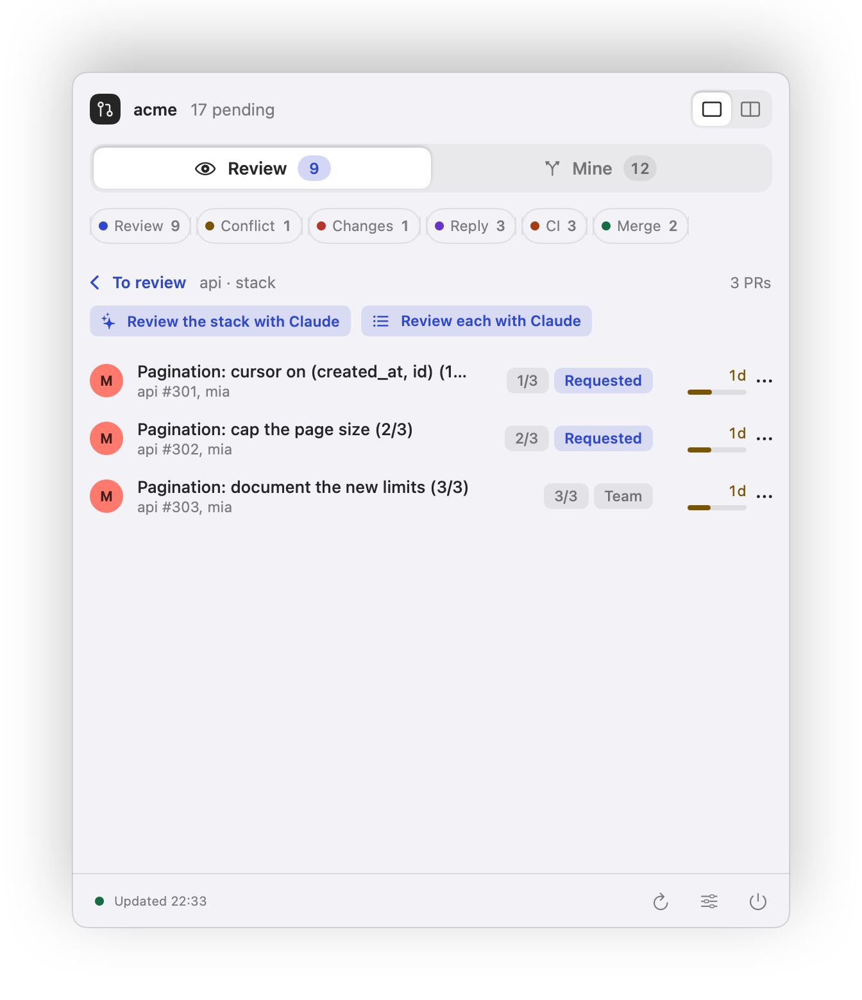
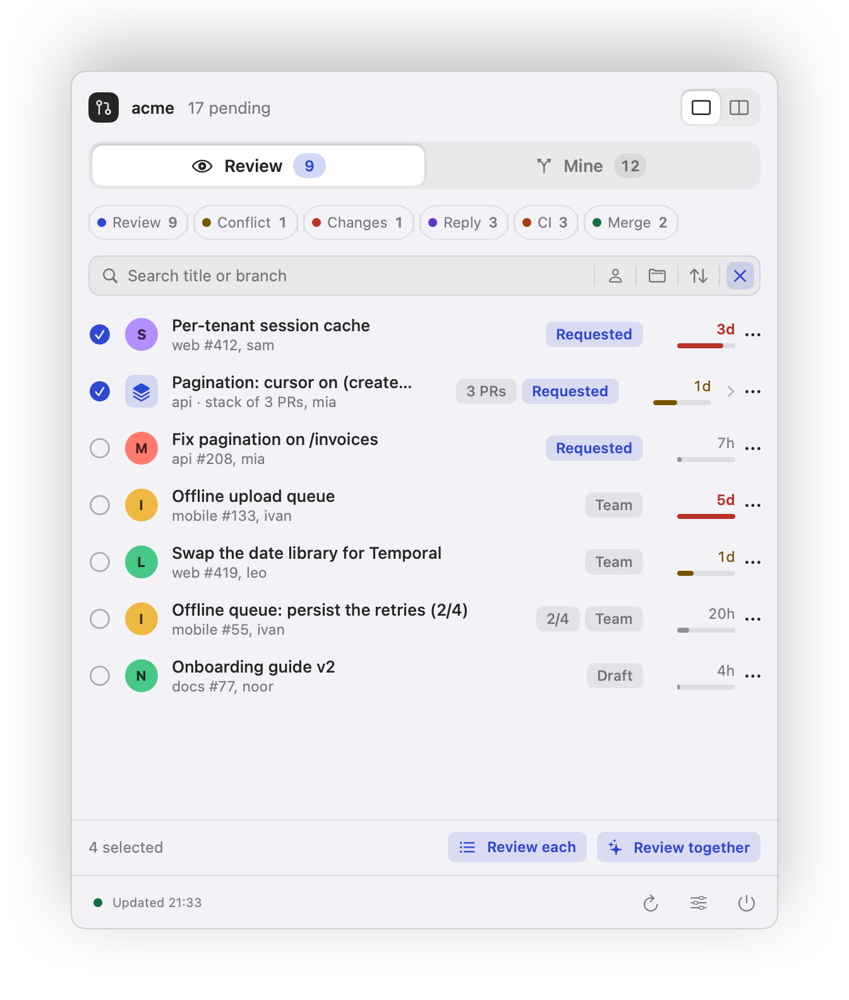
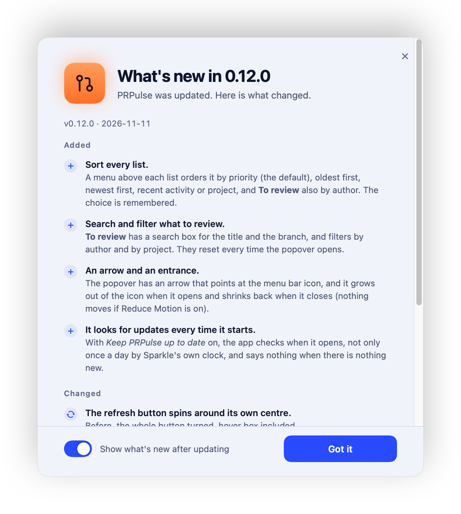

<p align="center">
  
</p>

<h1 align="center">PRPulse</h1>

<p align="center">
  <b>Saiba quais pull requests precisam de você, antes que alguém precise cobrar.</b><br>
  Um app nativo de barra de menu para macOS que acompanha as suas organizações do GitHub e mostra o que exige uma ação sua.
</p>

<p align="center">
  <a href="README.md">English</a> ·
  <a href="#instalação">Instalação</a> ·
  <a href="#o-que-você-recebe">O que você recebe</a> ·
  <a href="#o-que-conta-como-precisa-de-você">O que conta</a> ·
  <a href="#privacidade">Privacidade</a> ·
  <a href="#desenvolvimento">Desenvolvimento</a>
</p>

<p align="center">
  <picture>
    <source media="(prefers-color-scheme: dark)" srcset="docs/images/hero-dark.png">
    
  </picture>
</p>

> [!NOTE]
> Os prints estão com a interface em inglês. O app segue o idioma do sistema e está disponível em português.

## Por quê

Reviewers deixam comentários que você só vê horas depois. Colegas abrem PRs que ficam dias sem review porque nada lembra você de olhar. E "o que eu preciso fazer hoje?" vira abrir cinco abas do GitHub.

O PRPulse consulta o GitHub a cada poucos minutos, mantém **duas listas curtas** na barra de menu e troca o ícone (mais uma notificação) assim que algo novo precisa de você. Ele gira em torno de uma pergunta: *o que está esperando por mim?*

## O que você recebe

- **Para revisar:** toda PR aberta de outras pessoas da organização, inclusive as que você já revisou. As que esperam por você vêm primeiro (as que pediram você, depois as que ninguém revisou), depois as que você revisou (as que podem subir na frente) e os rascunhos. Um aviso marca as PRs com conflito de merge, e cada linha mostra há quanto tempo a PR espera (âmbar depois de 1 dia, vermelho depois de 3). Só as que esperam o seu review contam no ícone.
- **Minhas PRs:** todas as suas PRs abertas, as mais urgentes primeiro: *Conflito*, depois o que precisa de resposta (*Ajustar*, *Responder*), depois *Corrigir CI* e *Merge*, depois as que ninguém revisou ainda, as em review e os rascunhos. Cada uma traz o verbo que resolve. Só as que pedem algo de você contam no ícone.
- **Filtros por ação** e dois layouts, visão única ou lado a lado. A escolha fica salva.
- **Ordenar e filtrar:** toda lista tem um menu de ordem (prioridade, a padrão, mais antigas, mais novas, atividade recente, projeto e, em *Para revisar*, autor), e a escolha fica salva. Em *Para revisar* você também busca por título e branch e filtra por autor e projeto; esses filtros zeram a cada abertura do popover. Uma PR que ninguém revisou ganha o botão *Copiar link* (ao passar o mouse) para você cobrar a pessoa certa.
- **Menu ⋯ em cada linha:** abrir no GitHub, copiar o link e, na lista de revisão, *Revisar com…* e *Silenciar o repositório*, sem abrir os Ajustes.
- **Uma ou várias organizações**, e um **atalho global**, ⌥⌘P, que abre e fecha o painel de qualquer lugar.
- **Um ícone que avisa antes de você olhar:** um glifo de pull request que acompanha o tema da barra quando está tudo em dia, vira uma pílula laranja com o número quando algo precisa de você, faz um anel de pulso quando chega um item novo e fica vermelho se não conseguir atualizar.
- **Menu do botão direito:** atualizar agora (⌘R), abrir no GitHub (buscas já filtradas pela sua organização), liga/desliga de notificações, Ajustes (⌘,), Sobre e Sair.
- **Assistente de configuração** com prévia ao vivo do popover (conexão, organizações, exceções, frequência, onde abrir os reviews e mascote), e uma tela de **Ajustes** que conta as alterações não salvas (⌘S salva) e tem uma aba **Novidades** com o que mudou em cada versão.
- **Um ícone no Dock enquanto uma janela está aberta:** com o assistente ou os Ajustes abertos, o PRPulse aparece no Dock e no ⌘Tab, para você achar a janela de novo depois de outro app passar na frente. Ao fechar a última, ele volta a ficar só na barra de menu.
- **Atualiza sozinho:** busca versões novas e instala em segundo plano (dá para desligar em Ajustes).
- **Um mascote no canto da tela:** um amiguinho no canto inferior direito que reage ao que acontece (alerta, comemora item novo, se preocupa com PR antiga, dorme quando está tudo em dia). Dá para arrastar, trocar de personagem e de tamanho, e adicionar o seu em `~/Library/Application Support/PRPulse/Mascots/`. Vem ligado e dá para desligar em Ajustes ou pelo menu do ícone.
- **Revisar com IA:** nas PRs para revisar, o menu `⋯` (e o botão direito) tem **Revisar com …**, com o destino que você escolheu em primeiro e os outros em **Revisar com…**. O PRPulse não roda o review: leva a PR até o app ou o terminal em que você já trabalha, com o pedido, a pasta e a skill no lugar, e você segue com todos os recursos desse app (aprovar comandos, trocar modelo, comentar na PR).
  - **Destinos:** Claude Desktop (nova sessão do Code, com o pedido e a pasta), Codex (app, nova conversa com a pasta como workspace), Cursor (abre o repositório e depois o pedido no chat), Claude Code, Codex e Cursor Agent no terminal, e um **comando personalizado**. Os apps só preenchem a mensagem e você aperta Enter; os terminais começam sozinhos.
  - **O terminal é seu:** os destinos de terminal abrem um script `.command` com o padrão do sistema, que é o app que o macOS usa para esse tipo de arquivo (o Terminal, a menos que você tenha mudado). Em Ajustes → Agentes → **Terminal** dá para escolher outro (iTerm, Ghostty e Warp aparecem quando instalados, e **Outro app…** aceita qualquer app). Se algum app não roda arquivos `.command`, use um comando personalizado.
  - **Comando personalizado:** pode usar `{prompt}`, `{url}`, `{urls}`, `{repo}`, `{number}` e `{folder}`; cada um entra como uma palavra entre aspas, então nada do que uma PR diz vira parte do comando, e o pedido vai no fim quando `{prompt}` não está lá.
  - **O pedido:** leva o endereço da PR, o foco (performance, segurança, padrão de código e do projeto) e um aviso para não publicar nada no GitHub a menos que você peça. Só o endereço e o número vão, nunca o título ou a descrição, que outras pessoas escreveram. Se você tem uma skill de review em `~/.claude` ou num plugin, os destinos do Claude a citam; Ajustes → Agentes deixa escolher a skill e editar o texto (`{url}`, `{urls}`, `{repo}`, `{number}` e `{skill}` são preenchidos).
  - **A pasta:** a sessão abre no clone do repositório (o PRPulse procura nas suas pastas de costume e pergunta quando não acha), ou no **projeto padrão** da organização, se você definiu um. O link do Cursor não leva pasta, então a janela dele é aberta na pasta antes.
  - **Limites dos links:** um link de app só preenche a mensagem. O Claude Desktop sempre pede para você confirmar a pasta que vem de um link, e um pedido que começa com `/` ou é grande demais para um link (cerca de 8.000 caracteres) é recusado com um aviso, e não cortado.
- **Cutucar:** dois tipos, pelo menu do botão direito de uma PR. No Mac da outra pessoa, o mascote pula e treme, toca um som e aparece uma notificação. Como é para ser notado, tem regras:
  - **Para conseguir um review:** numa PR sua que ainda não tem os reviews, **Cutucar** lista qualquer pessoa do time (quem aparece nas PRs que o PRPulse lê) que ainda não revisou. Quem participou da PR continua na lista depois que você sobe um commit depois da última atividade da pessoa.
  - **Para fazer o merge:** numa PR de outra pessoa que você revisou e que já tem os reviews necessários, **Avisar rita que já pode subir** cutuca o autor. Só os reviews contam: check falhando ou conflito não impedem. Se o repositório não exige review, vale a sua aprovação.
  - **Um orçamento por pessoa e por PR:** pelo menos três horas entre cutucadas na mesma PR para a mesma pessoa, e no máximo três. Cada uma é mais forte que a anterior: o som toca uma vez, depois duas, depois três. Cutucar a mesma pessoa em outra PR recomeça a contagem.
  - **Uma frase sua, ou nenhuma:** **Cutucar** é um clique por pessoa. **Cutucar com mensagem…** acrescenta até 140 caracteres, que aparecem na notificação e num comentário na PR, onde todo mundo lê.
  - **Para quando termina:** o mascote fica inquieto até a pessoa abrir a PR, e uma segunda notificação sai depois de 15 minutos se ela não abriu. A cutucada chega na próxima atualização dela, então pode levar até o intervalo configurado (1 a 30 minutos).
  - **Pelo GitHub:** a cutucada para conseguir review pede o review de novo e deixa um comentário com um marcador escondido; a para fazer o merge só deixa o comentário. Quem não usa o PRPulse vê uma menção comum. Não precisa de servidor, e é a única coisa que o PRPulse escreve no GitHub.
  - **Para quem recebe, vem ligado** (Ajustes → **Notificações**: **Reagir a cutucadas** e **Som da cutucada**). O menu do botão direito do mascote tem **Pausar cutucadas**, por uma hora ou até amanhã de manhã. O som é o Sosumi, a menos que você escolha outro: a linha **Som** da mesma página lista os sons do macOS e tem um botão para ouvir. Para usar o seu, clique em **Abrir a pasta de sons** e coloque nela um arquivo `.wav`, `.caf`, `.aiff`, `.m4a` ou `.mp3` (`~/Library/Application Support/PRPulse/Sounds`); ele aparece na lista, e o que passar de três segundos é cortado. Se o arquivo sumir, toca o Sosumi.
- **Stacks e várias PRs de uma vez:** as PRs de uma [stack do GitHub](https://docs.github.com/pt/pull-requests/get-started/about-stacked-prs) aparecem juntas numa linha só, com um ícone de camadas, quantas são e um `1/3` em cada uma. Ao clicar, a lista vira a stack, da base ao topo, com **Revisar a stack** (uma conversa que vê todas, da base ao topo) e, num destino de terminal, **Revisar cada uma**. Quando a sua lista tem só algumas PRs de uma stack, a linha diz (`2 de 4 PRs de uma stack`). Num host sem stacks, como o GitHub Enterprise Server, cada PR aparece na sua própria linha.
  - **Várias de uma vez:** para PRs que são da mesma funcionalidade sem ser uma stack, como uma em cada repositório, **Selecionar** (acima da lista) põe uma caixa em cada linha: marque as que quiser, uma stack marca todas as suas PRs, e escolha **Revisar juntas** ou, num destino de terminal, **Revisar cada uma**. Um review de vários repositórios abre na pasta do primeiro.
- **Silencioso por padrão:** os comentários de bots não pedem resposta e as PRs que eles abrem, como as do Dependabot, ficam fora da lista de revisão (dois interruptores em Ajustes, ambos ligados por padrão), a primeira execução não despeja o backlog antigo em notificações e cada item avisa uma vez.

<table>
  <tr>
    <td width="50%" align="center">
      <picture>
        <source media="(prefers-color-scheme: dark)" srcset="docs/images/popover-dark.png">
        
      </picture>
    </td>
    <td width="50%" align="center">
      <picture>
        <source media="(prefers-color-scheme: dark)" srcset="docs/images/wizard-dark.png">
        
      </picture>
    </td>
  </tr>
</table>

<table>
  <tr>
    <td width="50%" align="center">
      <picture>
        <source media="(prefers-color-scheme: dark)" srcset="docs/images/stack-dark.png">
        
      </picture>
      <br><sub>Uma stack, aberta</sub>
    </td>
    <td width="50%" align="center">
      <picture>
        <source media="(prefers-color-scheme: dark)" srcset="docs/images/batch-dark.png">
        
      </picture>
      <br><sub>Várias marcadas</sub>
    </td>
  </tr>
</table>

## Instalação

### Homebrew

```bash
brew tap felipeferrarini/tap
brew trust felipeferrarini/tap
brew install --cask prpulse
```

Versões recentes do Homebrew não carregam casks de um tap de terceiros até você confiar nele, e é isso que a linha `brew trust` faz. Versões antigas não têm esse comando; pule a linha.

### Download

Baixe o `PRPulse-<versão>.dmg` na [página de releases](https://github.com/felipeferrarini/prpulse/releases/latest), arraste o **PRPulse** para Aplicativos e abra.

> [!IMPORTANT]
> O app ainda não é assinado com um Apple Developer ID, então na primeira abertura o macOS avisa que ele "não foi aberto". Clique em **OK** (não em "Mover para o Lixo"), depois vá em **Ajustes do Sistema → Privacidade e Segurança**, role até a seção de Segurança e clique em **Abrir Mesmo Assim** ao lado do PRPulse. O botão só aparece depois de uma tentativa de abertura bloqueada, e por cerca de uma hora.
>
> Prefere o terminal? Isto faz o mesmo:
>
> ```bash
> xattr -dr com.apple.quarantine /Applications/PRPulse.app
> ```
>
> Isso é só na primeira instalação: as atualizações automáticas não devem pedir de novo.

### Compilar você mesmo

Um app compilado localmente não é colocado em quarentena, então não há esse passo:

```bash
git clone https://github.com/felipeferrarini/prpulse && cd prpulse
make install
```

Você precisa de macOS 14 ou mais novo e do toolchain Swift (Xcode ou as Command Line Tools). O build é universal (Apple silicon e Intel).

## Primeira execução

1. **Conexão:** reaproveite o login do [`gh`](https://cli.github.com) ou cole um token pessoal com os escopos `repo` e `read:org`. Sem login, **Entrar com o GitHub** roda o `gh auth login` por você (mostra o código, copia e abre a página), e **Gerar token no GitHub** abre a página de token com os escopos já marcados.
2. **Organizações:** escolha uma ou mais. As que você mais usou nos últimos 90 dias vêm primeiro, com a contagem.
3. **Exceções:** marque repositórios para ignorar (eles são listados a partir da organização) e edite as contas de bot a pular. Ali também há dois interruptores: ignorar comentários de bots e ignorar as PRs que eles abrem.
4. **Ajustes:** frequência de atualização, notificações, abrir ao iniciar o Mac e atualizações automáticas. Em Ajustes há também uma aba de **Diagnóstico**, com um botão que copia as informações para um relato de problema (sem token, nem nomes de organização ou de PR), e a aba **Novidades**, que mostra o que mudou em cada versão; depois de uma atualização, uma janela mostra as novidades uma vez (dá para desligar).
5. **Revisão com IA:** ligue ou desligue e escolha onde abrir (Claude Desktop, Codex, Cursor, um terminal ou o seu comando).
6. **Mascote:** escolha o personagem que fica no canto da tela, ou desligue.

<p align="center">
  <picture>
    <source media="(prefers-color-scheme: dark)" srcset="docs/images/news-dark.png">
    
  </picture>
</p>

> [!NOTE]
> Se a sua organização exige SAML SSO, autorize o token para ela no GitHub, senão o ícone vai para o estado de erro. O mesmo acontece se a organização for renomeada ou o token não enxergá-la. Tokens clássicos precisam do escopo `repo`, ou os repositórios privados nunca aparecem.

## Entrar com o OAuth App do seu time

Para um time, o jeito mais simples é um OAuth App que alguém registra uma vez. Todo o resto entra pelo navegador, sem token e sem `gh`. O Client ID do app é público (o device flow não usa segredo), então pode ser compartilhado.

1. Um dono da sua organização abre **Settings → Developer settings → OAuth Apps → New OAuth App** (na organização, para que ela confie no app desde o começo).
2. Preencha o nome (PRPulse), a homepage (este repositório) e qualquer callback, como `http://localhost`. Marque **Enable Device Flow**, registre o app e copie o **Client ID**. Não gere um client secret: o PRPulse nunca usa um.
3. Cada pessoa escolhe **Entrar pelo navegador** (no assistente ou em Ajustes → Conexão), cola o Client ID e clica no botão. O PRPulse mostra um código, abre github.com/login/device e guarda o token no Keychain.

Para distribuir para o time todo, defina o Client ID nas preferências do app e o campo já vem preenchido:

```bash
defaults write io.github.felipeferrarini.prpulse OAuthClientID -string "Iv1.0123456789abcdef"
```

Um perfil de configuração (MDM) pode definir a mesma chave `OAuthClientID` nesse domínio. Um app que pertence a uma pessoa, e não à organização, pode precisar da aprovação de um dono quando a organização restringe apps de terceiros. O login pede os escopos `repo` e `read:org`.

## O que conta como "precisa de você"

### Minhas PRs

| Ação | Quando aparece |
| --- | --- |
| **Conflito** | a PR não pode ser integrada por causa de conflitos |
| **Ajustar** | um reviewer pediu alterações |
| **Responder** (threads abertas) | há threads de review sem resolver; resolva para limpar |
| **Responder** (comentário) | o último comentário de outra pessoa é mais novo que o seu último commit e o seu último comentário (aprovações com um "LGTM" no corpo não contam) |
| **Corrigir CI** | um check obrigatório está falhando (se o repositório não define nenhum, qualquer check que falhar) |
| **Merge** | o botão de merge está habilitado |

Uma PR com vários motivos aparece uma vez, com o mais urgente em destaque e um `+1` para os demais, na ordem acima. As suas próprias PRs em rascunho só mostram motivos de feedback.

### Para revisar

Todas as PRs abertas de outras pessoas na organização, nesta ordem por padrão: pedidos a você, PRs que ninguém revisou ainda, PRs que você revisou e podem subir, PRs que você revisou e ainda não podem, e rascunhos; dentro de cada grupo, as mais antigas na frente. Só os dois primeiros grupos precisam de você, então só eles contam no ícone e nas notificações. Uma PR que você revisou continua na lista (com a etiqueta *Revisada*, ou *Pode subir* quando dá para fazer o merge) e só volta a precisar de você se pedirem um novo review. Uma PR com conflito de merge ganha um pequeno aviso.

## Privacidade

- O PRPulse fala **só com o GitHub** (`api.github.com` e `github.com`), com as suas próprias credenciais. Não há servidor nosso, análise de uso nem telemetria.
- Um token pessoal fica no **Keychain do macOS**. Com a opção `gh`, o token é lido do `gh` na hora e nunca guardado pelo PRPulse.
- **Revisar com IA** só abre um app ou um terminal no seu Mac. O PRPulse não envia nada para lugar nenhum por causa disso: o endereço e o número da PR vão no pedido, e o que o app faz com ele segue os termos dele. Para os destinos de terminal, o pedido vai para um arquivo `.command` temporário, que o PRPulse apaga depois de uma hora.
- A única coisa que o PRPulse escreve no GitHub é uma **cutucada**, e só quando você pede: um novo pedido de review àquela pessoa e um comentário na sua própria PR. Nada mais é criado, editado ou apagado.
- A checagem de atualização lê um arquivo pequeno da página de releases em `github.com`. Nada sobre você ou o seu Mac é enviado.
- As atualizações são assinadas com uma chave que só quem mantém o projeto tem, e o app recusa o que não bater.
- O app é código aberto (MIT), então tudo isso pode ser conferido.

## Limites conhecidos

- Entrar pelo navegador ainda não existe; use o `gh` ou um token.
- O app é assinado ad hoc, então depois de cada atualização o macOS pode perguntar de novo se o PRPulse pode ler o item do Keychain. Escolha **Sempre Permitir**; se negar, o ícone mostra o estado de erro.
- Revisar com IA precisa do app ou do comando que você escolheu instalado. *Revisar cada uma* exige um destino de terminal, porque o link de um app só preenche uma mensagem por vez.
- As stacks vêm das PRs empilhadas do próprio GitHub. Num host sem elas, como o GitHub Enterprise Server, cada PR aparece na sua própria linha.
- Versões anteriores à 0.3.0 não se atualizam sozinhas: instale a mais recente uma vez, à mão ou com `brew upgrade`.

## Desenvolvimento

```bash
make test         # testes unitários
make app          # build universal, assinado ad hoc, em build/PRPulse.app
make dmg          # build/PRPulse-<versão>.dmg
make install      # compila e copia para /Applications
make screenshots  # gera de novo as imagens de docs/images com dados fictícios
make release      # DMG mais o feed de atualização assinado (build/feed/appcast.xml)
```

`PRPulseCore` guarda as regras e o cliente do GitHub como código puro e testado; `PRPulse` é a casca do macOS. Rode o app com dados fictícios usando `PRPULSE_DEMO=pending|fresh|empty|error|unconfigured|many`. Veja a seção [Development](README.md#development) do README em inglês para a estrutura completa.

## Contribuindo

Issues e pull requests são bem-vindos; veja o [CONTRIBUTING](CONTRIBUTING.md) (em inglês). Mantenha as regras do `PRPulseCore` cobertas por testes e rode `make test` antes de abrir uma PR.

## Licença

[MIT](LICENSE) © Felipe Ferrarini
